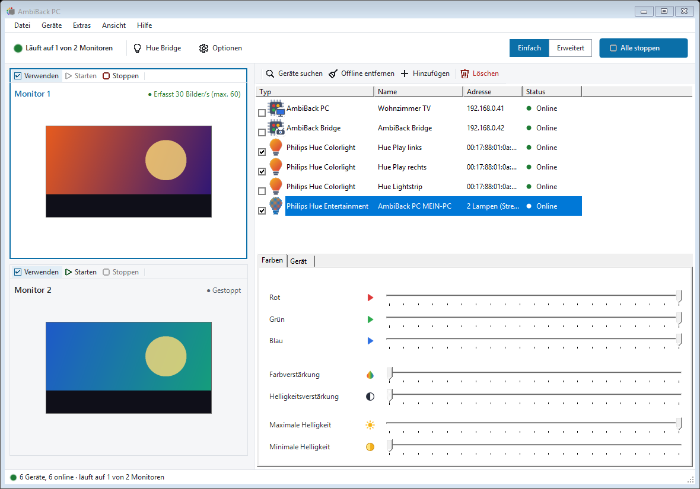

# AmbiBack PC

[English](README.md) · **Deutsch**

Umgebungslicht für deinen Windows-PC. AmbiBack PC erfasst den Inhalt deiner Monitore und schickt die Farben in Echtzeit an AmbiBack-LED-Controller, WLED- und andere DDP-LED-Streifen, Govee-Leuchten, Nanoleaf-Panels, LIFX-Lampen, PC-Beleuchtung über OpenRGB sowie Philips-Hue-Lampen. So „läuft“ das Bild an die Wand weiter.

Es gehört zum [AmbiBack-Projekt](https://github.com/ambiback) und arbeitet mit der [AmbiBack-Firmware](https://github.com/ambiback/ambiback-firmware).

## Download

Die aktuelle Version gibt es auf der [Release-Seite](https://github.com/ambiback/ambiback-pc/releases/latest):

- **`AmbiBack-PC-<Version>-setup.exe`** – Setup auf Deutsch oder Englisch, installiert ohne Administratorrechte. Empfohlen.
- **`AmbiBack-PC-<Version>.zip`** – portable Version, einfach entpacken.

Voraussetzung ist Windows 10 oder 11. Die Dateien sind nicht signiert, daher kann Windows SmartScreen beim ersten Start warnen: Klicke auf **Weitere Informationen** und dann auf **Trotzdem ausführen**.

## Schnellstart

1. AmbiBack PC installieren und starten. Fragt die Windows-Firewall, für **private Netzwerke** erlauben.
2. Lichtquellen hinzufügen: AmbiBack-Controller, WLED-Geräte, LIFX-Lampen, Govee-Leuchten (mit eingeschalteter LAN-Steuerung) und OpenRGB-Geräte (mit gestartetem SDK-Server) werden automatisch gefunden; für Philips Hue auf **Hue Bridge** klicken, den Link-Knopf an der Bridge drücken und **Verbinden** klicken; ein Nanoleaf wird einmal über **Hinzufügen** und seinen Ein-/Aus-Knopf gekoppelt.
3. Auf einer Monitor-Karte **Verwenden** klicken, in der Geräteliste die Lichtquellen für diesen Monitor anhaken und **Starten** klicken.

Schritt für Schritt mit Screenshots: **[Schnellstart](docs/de/quick-start.md)**.

## Benutzerhandbuch

Das [Benutzerhandbuch](docs/benutzerhandbuch.md) enthält:

- [Installation](docs/de/installation.md)
- [Schnellstart](docs/de/quick-start.md)
- [AmbiBack-Geräte](docs/de/ambiback-devices.md) – WLAN-Einrichtung über USB, LED-Anordnung
- [Philips Hue](docs/de/philips-hue.md) – Hue Entertainment, Bridge, Lampen, Bereiche
- [Netzwerk-Leuchten Schritt für Schritt](docs/de/network-lights.md) – Tutorial für WLED, Govee, OpenRGB, Nanoleaf und LIFX
- [WLED und DDP](docs/de/wled.md), [Govee](docs/de/govee.md), [OpenRGB](docs/de/openrgb.md), [Nanoleaf](docs/de/nanoleaf.md), [LIFX](docs/de/lifx.md)
- [Das Hauptfenster](docs/de/main-window.md) und [Einstellungen](docs/de/settings.md)
- [Problemlösung und FAQ](docs/de/troubleshooting.md) – Firewall, SmartScreen, Hue

## Funktionen

- Bildschirmaufnahme über DirectX mit Live-Vorschau, für einen oder mehrere Monitore
- AmbiBack-Controller über WLAN (UDP oder TCP) oder USB, automatisch im lokalen Netzwerk gefunden
- WLED und andere DDP-Empfänger (ESPHome, Hyperion, ESPixelStick …) mit bis zu 60 fps, WLED-Suche per mDNS
- Govee-Leuchten über die Govee-LAN-API, ohne Cloud und Konto: Segmentfarben bei Modellen mit DreamView, eine Farbe bei jedem Modell
- PC-Beleuchtung über das OpenRGB-SDK: Mainboard, Arbeitsspeicher, Grafikkarte, Lüfter, LED-Streifen, Tastaturen und mehr, als Streifen um den Bildschirm oder in einer Farbe
- Nanoleaf-Panels (Light Panels, Canvas, Shapes, Elements, Lines) über die Open API: Jedes Panel zeigt das Bild an seiner Stelle in der Anordnung
- LIFX-Lampen über das LAN-Protokoll, ohne Cloud und Konto: Glühbirnen in einer Farbe, LIFX Z / Beam / Neon Zone für Zone um den Bildschirm
- Philips Hue über die Entertainment API: verschlüsseltes Streaming mit 25 bis 50 fps, automatische Bridge-Suche, eigener Entertainment-Bereich aus den gewählten Lampen
- Helligkeit, Farbanteile, Farbverstärkung und Glättung je Gerät
- Start mit Windows und Betrieb im Infobereich
- Oberfläche auf Deutsch und Englisch

## Status

- Version 1.0. Philips Hue (Entertainment-Streaming, Bridge-Suche, eigener Entertainment-Bereich) wurde mit einer echten Hue Bridge v2 getestet. Andere Teile der Anwendung sind seit der Migration weniger getestet.
- **Tester gesucht:** WLED und Philips Hue werden mit den eigenen Geräten des Entwicklers getestet, Govee vielleicht bald. OpenRGB, Nanoleaf und LIFX sind nach den Protokollbeschreibungen entstanden und nur gegen nachgebaute Geräte getestet. Wenn du eines davon hast, teste bitte und [melde, wie es klappt](docs/de/network-lights.md#test-melden).
- AmbiBack-Geräte werden seit rund fünf Jahren nicht mehr verkauft. Dieses Projekt dient dem Eigenbau und der Weiterentwicklung, ohne Produktsupport. Mehr auf [ambiback.de](https://www.ambiback.de/); die Bauteile für den Selbstbau stehen auf der [AmbiBack-Teileseite](https://www.ambiback.de/selbstbau/teile/).

## Sicherheit

Die Kommunikation mit AmbiBack-, WLED/DDP- und Govee-Geräten sowie mit dem OpenRGB-SDK-Server, Nanoleaf und LIFX läuft unverschlüsselt im lokalen Netz, und die Geräte-API hat keine Anmeldung. Betreibe die Geräte nur in einem vertrauenswürdigen Netz. Das Hue-Streaming ist verschlüsselt (DTLS, AES-GCM), Verwaltungsbefehle an die Bridge laufen über HTTPS, und der Bridge-Schlüssel wird mit Windows DPAPI gespeichert.

## Für Entwickler

Bauen, Setup, Selbsttests, CI und Releases: [docs/de/development.md](docs/de/development.md).

## Marken

Philips Hue, DreamScreen, WLED, Govee, Razer Chroma, OpenRGB, Nanoleaf und LIFX sind Marken bzw. Namen ihrer jeweiligen Inhaber. Dieses Projekt steht in keiner Verbindung zu ihnen.

## Lizenz

Copyright (C) 2019-2026 Andre Lorbach

Dieses Programm ist freie Software unter der [GNU General Public License Version 3](LICENSE). Es wird ohne Gewährleistung bereitgestellt. Code von Dritten behält seine eigene Lizenz, siehe [THIRD_PARTY_NOTICES.md](THIRD_PARTY_NOTICES.md).
