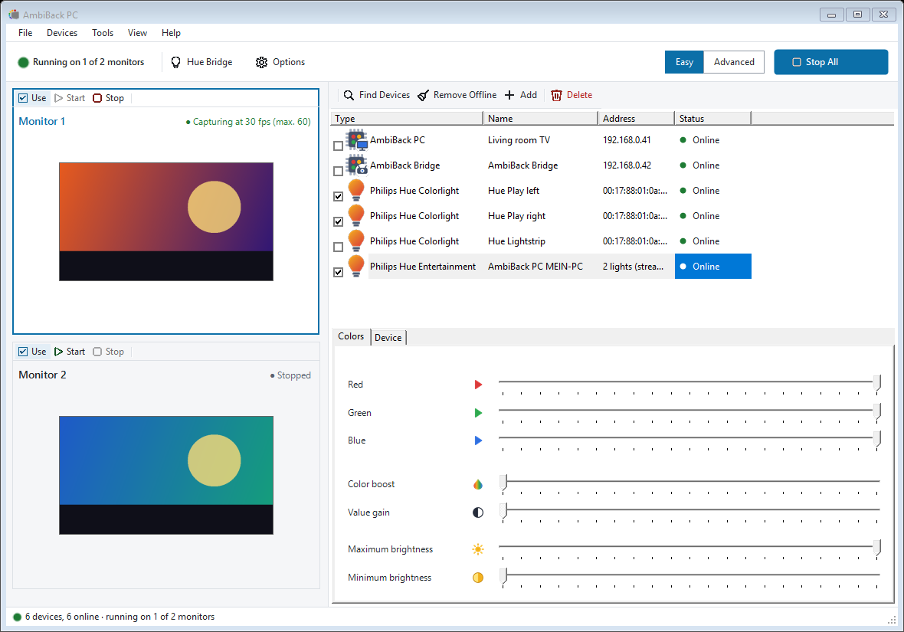

# AmbiBack PC

**English** · [Deutsch](README.de.md)

Ambient light for your Windows PC. AmbiBack PC captures what your monitors show and sends the colors in real time to AmbiBack LED controllers, WLED and other DDP LED strips, Govee lights, and Philips Hue lights, so the picture seems to flow onto the wall.

It is part of the [AmbiBack project](https://github.com/ambiback) and works with the [AmbiBack firmware](https://github.com/ambiback/ambiback-firmware).

## Download

Get the latest version from the [releases page](https://github.com/ambiback/ambiback-pc/releases/latest):

- **`AmbiBack-PC-<version>-setup.exe`** – setup in German or English, installs without administrator rights. Recommended.
- **`AmbiBack-PC-<version>.zip`** – portable version, just unzip.

Windows 10 or 11 is required. The files are not code-signed, so Windows SmartScreen may warn on first start: click **More info**, then **Run anyway**.

## Quick start

1. Install and start AmbiBack PC. When Windows Firewall asks, allow it on **private networks**.
2. Add your lights: AmbiBack controllers, WLED devices and Govee lights (with LAN Control on) are found on their own; for Philips Hue click **Hue Bridge**, press the link button on the bridge and click **Connect**.
3. Click **Use** on a monitor card, tick the lights for this monitor in the device list and click **Start**.

Step by step with screenshots: **[Quick start](docs/en/quick-start.md)**.

## User guide

The [user guide](docs/user-guide.md) covers:

- [Installation](docs/en/installation.md)
- [Quick start](docs/en/quick-start.md)
- [AmbiBack devices](docs/en/ambiback-devices.md) – Wi-Fi setup over USB, LED layout
- [Philips Hue](docs/en/philips-hue.md) – Hue Entertainment, bridge, lights, areas
- [WLED and DDP](docs/en/wled.md) – WLED and other DDP receivers
- [The main window](docs/en/main-window.md) and [settings](docs/en/settings.md)
- [Troubleshooting and FAQ](docs/en/troubleshooting.md) – firewall, SmartScreen, Hue

## Features

- Screen capture through DirectX with live preview, for one or several monitors
- AmbiBack controllers over Wi-Fi (UDP or TCP) or USB, found on their own on the local network
- WLED and other DDP receivers (ESPHome, Hyperion, ESPixelStick …) at up to 60 fps, WLED found over mDNS
- Govee lights over the Govee LAN API, without cloud or account: segment colors on models with DreamView, one color on any model
- Philips Hue through the Entertainment API: encrypted streaming at 25 to 50 fps, automatic bridge discovery, an entertainment area of its own from the lights you choose
- Brightness, color balance, color boost and smoothing per device
- Start with Windows and run from the notification area
- German and English user interface

## Status

- Version 1.0. Philips Hue (Entertainment streaming, bridge discovery, own entertainment area) was tested against a real Hue Bridge v2. Other parts of the application are tested less after the migration.
- AmbiBack devices have not been on sale for around five years. This project is for DIY use and further development, with no product support. More at [ambiback.de](https://www.ambiback.de/); the parts for a DIY build are on the [AmbiBack parts page](https://www.ambiback.de/en/diy/parts/).

## Security

Communication with AmbiBack, WLED/DDP and Govee devices is unencrypted on the local network, and the device API has no login. Run devices only on a trusted network. Hue streaming is encrypted (DTLS, AES-GCM), management commands to the bridge use HTTPS, and the bridge key is stored with Windows DPAPI.

## For developers

Building, setup, self tests, CI and releases: [docs/en/development.md](docs/en/development.md).

## Trademarks

Philips Hue, DreamScreen, WLED, Govee and Razer Chroma are trademarks or names of their respective owners. This project is not affiliated with them.

## License

Copyright (C) 2019-2026 Andre Lorbach

This program is free software under the [GNU General Public License version 3](LICENSE). It comes with no warranty. Third-party code keeps its own license, see [THIRD_PARTY_NOTICES.md](THIRD_PARTY_NOTICES.md).
