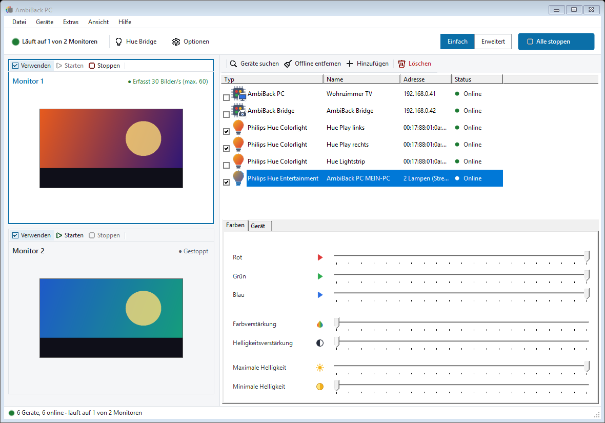
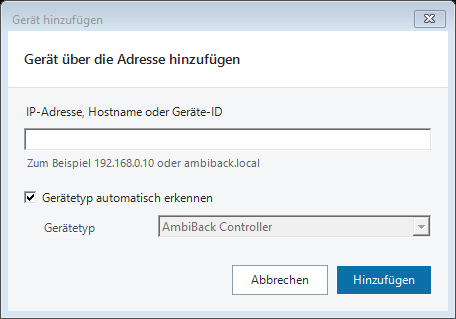
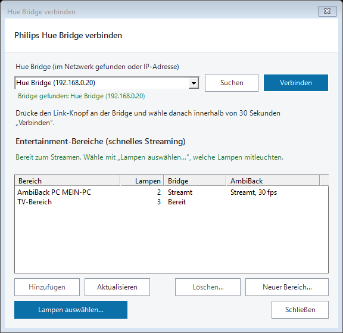
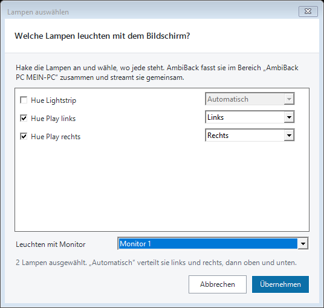
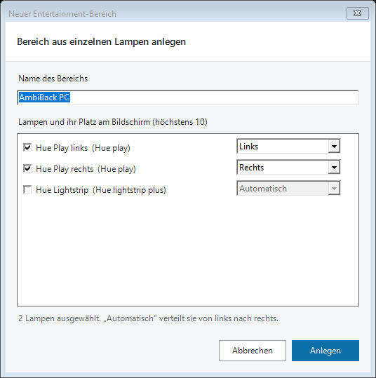
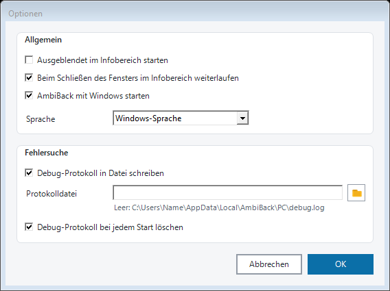

# AmbiBack PC – Benutzerhandbuch

[English](user-guide.md) · **Deutsch**

AmbiBack PC erfasst den Inhalt deiner Monitore und schickt die Farben in Echtzeit an Lichtquellen hinter oder neben dem Bildschirm: AmbiBack-Controller (LED-Streifen), Philips-Hue-Lampen und, in Builds mit DreamScreen-Unterstützung, DreamScreen-Geräte. So „läuft“ das Bild an die Wand weiter.

Dieses Handbuch erklärt alle Fenster der App, die Einrichtung von AmbiBack-Geräten und Philips Hue und hilft bei Problemen.

## Inhalt

1. [Voraussetzungen und Start](#1-voraussetzungen-und-start)
2. [Das Hauptfenster](#2-das-hauptfenster)
3. [AmbiBack-Geräte einrichten](#3-ambiback-geräte-einrichten)
4. [Monitore und Bildbereiche](#4-monitore-und-bildbereiche)
5. [Farben und Geräteeinstellungen](#5-farben-und-geräteeinstellungen)
6. [Philips Hue](#6-philips-hue)
7. [Optionen](#7-optionen)
8. [Infobereich (Tray)](#8-infobereich-tray)
9. [Problemlösung](#9-problemlösung)
10. [Datenschutz und Sicherheit](#10-datenschutz-und-sicherheit)

---

## 1. Voraussetzungen und Start

- Windows 10 oder 11 mit .NET Framework 4.7.2 oder neuer (bei aktuellen Windows-Versionen bereits vorhanden).
- Für die Geräte-Webseiten und die Kalibriervideos: Microsoft Edge WebView2 Runtime (meist schon installiert).
- PC und Lichtquellen im selben lokalen Netzwerk; für USB-Geräte gegebenenfalls der Treiber des USB-Chips (siehe [README](../README.de.md#usb-treiber)).

Starte `AmbiBack.exe`. Beim ersten Start sucht AmbiBack nach Geräten im Netzwerk und an den USB-Anschlüssen. Die App läuft nur einmal; ein zweiter Start holt das vorhandene Fenster nach vorne.

Einstellungen und Geräteliste liegen im Programmordner, wenn dieser beschreibbar ist (portable Nutzung), sonst unter `%LOCALAPPDATA%\AmbiBack\PC`.

## 2. Das Hauptfenster

Das Fenster hat vier Bereiche:

**Toolbar (oben)**

| Element | Bedeutung |
| --- | --- |
| Statuspunkt und Text | Grün: AmbiBack läuft, mit Anzahl der aktiven Monitore. Grau: gestoppt. |
| **Hue Bridge** | Öffnet die Verbindung zur Philips Hue Bridge (siehe [Kapitel 6](#6-philips-hue)). |
| **Optionen** | Autostart, Sprache, Protokoll (siehe [Kapitel 7](#7-optionen)). |
| **Einfach / Erweitert** | Einfach zeigt nur das Nötige. Erweitert zeigt zusätzlich den Reiter *Debug* und die Listenansichten. |
| **Alle starten / Alle stoppen** | Startet oder stoppt das Umgebungslicht auf allen verwendeten Monitoren. |

Alle Toolbar-Befehle gibt es auch im Menü: *Datei* (Alle starten/stoppen, Optionen, Beenden), *Geräte* (Suchen, Hinzufügen, Details, WLAN, Offline entfernen, Löschen), *Extras* (Hue Bridge, Kalibriervideos), *Ansicht* und *Hilfe*.

**Monitor-Karten (links)** – eine Karte pro angeschlossenem Monitor mit Live-Vorschau und Status (z. B. „Erfasst 30 Bilder/s“). Siehe [Kapitel 4](#4-monitore-und-bildbereiche).

**Geräteliste (rechts oben)** – alle gefundenen Lichtquellen mit Typ, Name, Adresse und Status (grüner Punkt = online, blauer Punkt = per USB verbunden). Der **Haken** vor einem Gerät ordnet es dem links ausgewählten Monitor zu. Bei Hue-Lampen hat der Haken eine eigene Bedeutung, siehe [Kapitel 6.4](#64-die-pc-gruppe-in-der-geräteliste).

**Einstellungen (rechts unten)** – Regler für das in der Liste ausgewählte Gerät (siehe [Kapitel 5](#5-farben-und-geräteeinstellungen)).

Die **Statusleiste** unten zeigt, wie viele Geräte online sind und auf wie vielen Monitoren AmbiBack läuft.

## 3. AmbiBack-Geräte einrichten

### Geräte suchen

**Geräte suchen** (oder `F5`) schickt eine Suchanfrage ins lokale Netzwerk und fragt die USB-Anschlüsse ab. Gefundene AmbiBack-Controller erscheinen in der Liste. Die Suche läuft auch automatisch beim Start.

### Gerät von Hand hinzufügen

Findet die Suche ein Gerät nicht (zum Beispiel in einem anderen Netzsegment), füge es über **Hinzufügen** hinzu:

1. IP-Adresse, Hostnamen (z. B. `ambiback.local`) oder Geräte-ID eingeben.
2. *Gerätetyp automatisch erkennen* angehakt lassen; AmbiBack fragt das Gerät dann selbst. Nur wenn das nicht klappt, den Typ von Hand wählen.
3. **Hinzufügen**.

### Weitere Befehle

- **Details** (Doppelklick auf ein Gerät) öffnet die Webseite des Controllers mit allen Firmware-Einstellungen.
- **Mit WLAN verbinden…** (Kontextmenü oder Menü *Geräte*, nur bei USB-Verbindung) sendet WLAN-Name und Passwort an einen neuen Controller. Er startet danach neu und erscheint im Netzwerk.
- **Offline entfernen** entfernt alle Geräte, die gerade nicht erreichbar sind; bei Hue-Lampen und Hue-Bereichen zählt, ob die Bridge sie zuletzt gemeldet hat.
- **Löschen** entfernt das ausgewählte Gerät aus der Liste. Ist es noch im Netz, findet *Geräte suchen* es wieder.

## 4. Monitore und Bildbereiche

Jede Monitor-Karte hat drei Schalter:

| Schalter | Bedeutung |
| --- | --- |
| **Verwenden** | Schaltet die Bildschirmerfassung für diesen Monitor ein. Erst dann lassen sich Geräte starten. |
| **Starten** | Startet das Umgebungslicht für alle Geräte, die diesem Monitor zugeordnet sind. |
| **Stoppen** | Stoppt sie wieder. Hue-Lampen gehen dabei aus. |

**Geräte zuordnen:** Klicke eine Monitor-Karte an (sie bekommt einen blauen Rahmen) und setze in der Geräteliste den Haken bei den Geräten, die zu diesem Monitor gehören. Ein Gerät kann an einem Monitor hängen, ein Monitor kann mehrere Geräte bedienen.

**Bildbereiche festlegen:** Wähle ein Gerät in der Liste aus. Die ausgewählte Monitor-Karte zeigt dann, welche Bildbereiche es auswertet:

- **AmbiBack-Controller:** Anzahl der LEDs *Vertikal* und *Horizontal* sowie über die Kästchen in den Ecken, wo der LED-Streifen beginnt und in welche Richtung er läuft (die Pfeile zeigen den Verlauf).
- **Hue-Lampe:** zwölf Sektoren am Bildrand (je drei rechts, oben, links und unten). Angehakte Sektoren werden gemittelt. Eine Lampe links neben dem Monitor bekommt also die linken Sektoren. Am einfachsten setzt du sie über den Assistenten [Lampen auswählen](#63-lampen-auswählen).
- **Hue-Entertainment-Bereich:** keine Sektoren; die Bereiche ergeben sich aus den Positionen der Lampen im Bereich (siehe [Kapitel 6.5](#65-entertainment-bereiche-aus-der-hue-app)).

Ist ein Monitor aus (Energiesparmodus), pausiert AmbiBack automatisch und schaltet Hue-Lampen aus.

## 5. Farben und Geräteeinstellungen

Die Regler gelten für das in der Liste ausgewählte Gerät und wirken sofort.

**Reiter „Farben“**

| Regler | Wirkung |
| --- | --- |
| Rot, Grün, Blau | Anteil der jeweiligen Farbe in Prozent, z. B. um einen Farbstich der LEDs oder der Wand auszugleichen. |
| Farbverstärkung | Hebt die vorherrschende Farbe hervor und dämpft die anderen; macht das Licht satter. |
| Helligkeitsverstärkung | Hellt dunkle Bilder auf (über 100 %). |
| Maximale Helligkeit | Obergrenze der Helligkeit. |
| Minimale Helligkeit | Untergrenze, damit es bei dunklen Szenen nicht ganz dunkel wird. |

**Reiter „Gerät“**

| Einstellung | Wirkung |
| --- | --- |
| Gerätename | Name des Geräts, sofern das Gerät eine Umbenennung unterstützt. |
| Verbindung | *UDP* funktioniert in jedem WLAN und ist Standard; *TCP* braucht ein stabiles WLAN; *USB* für direkt angeschlossene Controller. |
| Bilder pro Sekunde | Wie oft Farben gesendet werden. Hue-Streaming: 25 bis 50. |
| Glättung | Übergangszeit zwischen Farben (nicht bei Hue; die Bridge glättet selbst). |
| Innerer Bildbereich (%) | Wie weit die Bildbereiche ins Bild hineinreichen. Bei Hue-Bereichen: Größe des Bereichs um jede Lampe. |

Im Modus *Erweitert* erscheint bei Controllern mit Debug-Unterstützung zusätzlich der Reiter **Debug** (Syslog-Ausgabe, Geräteinfo, Neustart).

## 6. Philips Hue

### 6.1 So funktioniert es

AmbiBack steuert Hue-Lampen ausschließlich über die **Hue Entertainment API**: Die Farben aller Lampen gehen verschlüsselt (DTLS) 25 bis 50 Mal pro Sekunde in einem Datenstrom an die Bridge, die sie synchron an die Lampen weitergibt. Das ist derselbe Weg, den die Hue-App für „Sync“ nutzt. Einzelne Farbbefehle über HTTP, die langsam sind und die Bridge überlasten, verwendet AmbiBack nicht.

Gestreamt wird immer an einen **Entertainment-Bereich** der Bridge. AmbiBack legt dafür einen eigenen Bereich an, **„AmbiBack PC <Rechnername>“**, und hält ihn mit deiner Lampenauswahl aktuell. Alternativ kannst du einen Bereich verwenden, den du in der Hue-App eingerichtet hast.

Voraussetzungen: eine Hue Bridge der zweiten Generation (eckig) mit aktueller Firmware und Farblampen, die Entertainment unterstützen. Steckdosen und reine Weißlampen werden nicht angezeigt.

### 6.2 Bridge verbinden

Klicke in der Toolbar auf **Hue Bridge**.

1. **Bridge wählen:** Beim ersten Öffnen sucht AmbiBack die Bridge automatisch und trägt sie ein („Bridge gefunden: …“). Hast du mehrere Bridges, klappt die Liste auf und du wählst eine aus. **Suchen** sucht erneut. Du kannst auch eine IP-Adresse von Hand eingeben.
2. **Link-Knopf drücken:** Drücke den runden Knopf oben auf der Bridge.
3. **Verbinden:** Klicke innerhalb von 30 Sekunden auf **Verbinden**. AmbiBack meldet sich an der Bridge an und erhält dabei den Schlüssel für das Streaming.
4. Danach öffnet sich automatisch der Assistent **Lampen auswählen**.

Die Statuszeile unter „Entertainment-Bereiche“ zeigt den Stand: *Nicht verbunden*, *ohne Streaming-Schlüssel* (dann Link-Knopf drücken und erneut verbinden) oder *Bereit zum Streamen*.

Die Liste zeigt alle Entertainment-Bereiche der Bridge mit der Anzahl der Lampen, ihrem Zustand auf der Bridge (*Streamt* / *Bereit*) und dem Zustand in AmbiBack (z. B. *Streamt, 30 fps*).

### 6.3 Lampen auswählen

Der Assistent erscheint nach dem Verbinden und jederzeit über **Lampen auswählen…** im Hue-Dialog.

1. **Lampen anhaken**, die mit dem Bildschirm leuchten sollen (höchstens 10, eine Grenze der Bridge).
2. **Platz wählen**, an dem jede Lampe steht: *Links*, *Rechts*, *Oben*, *Unten* oder eine Ecke. *Automatisch* verteilt die Lampen links und rechts, dann oben und unten. Daraus ergeben sich die Bildbereiche, die jede Lampe auswertet.
3. **Monitor wählen**, mit dem die Lampen leuchten.
4. **Übernehmen**: AmbiBack legt den Bereich „AmbiBack PC <Rechnername>“ an oder passt ihn an und ordnet ihn dem Monitor zu. Läuft der Monitor schon, leuchten die Lampen sofort.

### 6.4 Die PC-Gruppe in der Geräteliste

Nach dem Assistenten stehen in der Geräteliste:

- **Philips Hue Entertainment „AmbiBack PC <Rechnername>“** – die Gruppe. **Nur sie wird einem Monitor zugeordnet und gestartet.** Sie streamt alle ihre Lampen gemeinsam.
- **Philips Hue Colorlight** – die einzelnen Lampen. Ihr **Haken bedeutet „gehört zur Gruppe“**, unabhängig vom ausgewählten Monitor. Hakst du eine Lampe an oder ab, passt AmbiBack die Gruppe auf der Bridge an, auch während des Betriebs; herausgenommene Lampen gehen aus. Wählst du eine Lampe aus, kannst du ihre Sektoren auf der Monitor-Karte und eigene Farbregler einstellen.

Einzelne Lampen senden nie selbst. Hast du keine Lampe angehakt, zeigt die Gruppe *Keine Lampen in der Gruppe*.

Beim **Stoppen**, bei **Monitor aus** und beim **Beenden** der App schaltet AmbiBack die Lampen aus. Beim Start schaltet es sie wieder ein.

### 6.5 Entertainment-Bereiche aus der Hue-App

Du kannst auch einen Bereich verwenden, den du in der Hue-App (*Einstellungen › Entertainment-Bereiche*) eingerichtet hast: Bereich in der Liste auswählen und **Hinzufügen** (oder Doppelklick). Er erscheint als eigenes Gerät, das du einem Monitor zuordnest. Jede Lampe bekommt den Bildbereich an ihrer Position im Bereich (links/rechts und Höhe). Haben die Lampen keine Position, verteilt AmbiBack sie von links nach rechts. Die Größe der Bildbereiche stellst du mit *Innerer Bildbereich (%)* ein.

Die Bridge streamt immer nur **einen** Bereich gleichzeitig. Verwende für dieselben Lampen also entweder die PC-Gruppe oder einen Bereich aus der Hue-App.

### 6.6 Eigenen Bereich anlegen und Bereiche löschen

**Neuer Bereich…** legt einen zusätzlichen Bereich aus frei gewählten Lampen und Plätzen an, zum Beispiel für einen zweiten Monitor:

**Löschen…** entfernt die markierten Bereiche nach einer Rückfrage von der Bridge. Die Lampen selbst bleiben erhalten. Das ist nötig, wenn die Bridge voll ist: Sie verwaltet **höchstens 20 Entertainment-Bereiche**.

## 7. Optionen

| Option | Bedeutung |
| --- | --- |
| Ausgeblendet im Infobereich starten | Das Fenster bleibt beim Start verborgen; AmbiBack läuft im Infobereich. |
| Beim Schließen des Fensters im Infobereich weiterlaufen | Das Schließen-Kreuz blendet das Fenster nur aus. Beenden über *Datei › Beenden* oder das Tray-Menü. |
| AmbiBack mit Windows starten | Trägt AmbiBack in den Windows-Autostart ein. |
| Sprache | Deutsch, Englisch oder die Windows-Sprache. |
| Debug-Protokoll | Schreibt ein Protokoll zur Fehlersuche; leer = Standardpfad. Hue-Schlüssel werden nie protokolliert. |

## 8. Infobereich (Tray)

Das AmbiBack-Symbol im Infobereich zeigt als Tooltip, ob und auf wie vielen Monitoren AmbiBack läuft. Das Kontextmenü bietet:

- Status
- **Alle Monitore starten** / **Alle Monitore stoppen**
- **AmbiBack anzeigen**
- **Beenden** (schaltet Hue-Lampen vorher aus)

## 9. Problemlösung

| Problem | Lösung |
| --- | --- |
| Die Hue Bridge wird nicht gefunden | Prüfe, ob PC und Bridge im selben Netz sind, und klicke **Suchen**. Hilft das nicht, trage die IP-Adresse von Hand ein (in der Hue-App unter *Einstellungen › Bridges › i*). |
| „Verbinden“ meldet einen Fehler | Den Link-Knopf an der Bridge drücken und **innerhalb von 30 Sekunden** auf *Verbinden* klicken. |
| „Ohne Streaming-Schlüssel“ | Die Verbindung stammt von einer älteren Version. Link-Knopf drücken und erneut *Verbinden*. |
| Die Hue-Lampen bleiben dunkel | Sind Lampen in der Gruppe angehakt (oder über *Lampen auswählen* gewählt)? Ist die Gruppe dem Monitor zugeordnet, und ist der Monitor gestartet? |
| Die Lampen flackern oder springen | Nur einen Weg pro Lampe nutzen: PC-Gruppe **oder** ein Bereich aus der Hue-App, nicht beides; keine andere Sync-App gleichzeitig. |
| „Die Bridge hat schon 20 Entertainment-Bereiche“ | Nicht benötigte Bereiche im Hue-Dialog mit **Löschen…** oder in der Hue-App entfernen. |
| Eine Lampe fehlt in der Auswahl | Nur Farblampen mit Entertainment-Unterstützung werden angezeigt; Steckdosen und Weißlampen nicht. |
| Ein AmbiBack-Controller wird nicht gefunden | Gerät eingeschaltet und im selben Netz? Sonst **Hinzufügen** mit IP-Adresse; bei USB den Treiber des USB-Chips installieren. |
| Offline-Einträge lassen sich nicht entfernen | **Offline entfernen** in der Geräte-Toolbar oder das Gerät auswählen und **Löschen**. |

Für die Fehlersuche lässt sich unter *Optionen* ein Debug-Protokoll einschalten. Entwickler können die Hue-Funktionen auch ohne Oberfläche prüfen: `AmbiBack.exe --hue-selftest` (Selbsttest der Verschlüsselung und Protokolle) und `AmbiBack.exe --hue-discover` (Bridges im Netzwerk suchen).

## 10. Datenschutz und Sicherheit

- Die Verbindung zu AmbiBack-Controllern läuft unverschlüsselt im lokalen Netz; die Geräte-API hat keine Anmeldung. Betreibe die Geräte nur in einem vertrauenswürdigen Netz.
- Das Hue-Streaming ist verschlüsselt (DTLS mit AES-GCM). Verwaltungsbefehle an die Bridge laufen über HTTPS (CLIP API v2); das Zertifikat der Bridge wird nur für ihre eigene Adresse akzeptiert.
- Den Streaming-Schlüssel der Bridge speichert AmbiBack verschlüsselt für dein Windows-Benutzerkonto (DPAPI).
- Zum Finden der Bridge fragt AmbiBack zuerst das lokale Netz (mDNS, ARP-Cache). Findet es dort nichts, oder klickst du auf **Suchen**, fragt es zusätzlich den Hue-Suchdienst `discovery.meethue.com`, den auch die Hue-App nutzt. Dabei werden keine Daten von dir übertragen; der Dienst sieht nur die Anfrage von deinem Internetanschluss.
