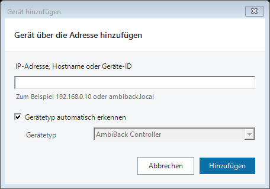

# AmbiBack-Geräte

[English](../en/ambiback-devices.md) · **Deutsch** · [Benutzerhandbuch](../benutzerhandbuch.md)

Ein AmbiBack-Controller steuert einen LED-Streifen hinter dem Monitor. Er läuft mit der [AmbiBack-Firmware](https://github.com/ambiback/ambiback-firmware) und ist über WLAN (UDP-Port 1337) oder USB erreichbar.

## Neuen Controller ins WLAN bringen

Ein Controller, der noch nie in deinem WLAN war, bekommt die WLAN-Daten über USB:

1. Verbinde den Controller per USB-Kabel mit dem PC. Erkennt Windows ihn nicht, installiere den Treiber seines USB-Chips ([FTDI VCP](https://ftdichip.com/drivers/vcp-drivers/) oder [Silicon Labs CP210x](https://www.silabs.com/developers/usb-to-uart-bridge-vcp-drivers)).
2. Klicke auf **Geräte suchen** (`F5`). Der Controller erscheint mit blauem Punkt (per USB verbunden).
3. Klicke ihn mit der rechten Maustaste an und wähle **Mit WLAN verbinden…** (auch im Menü *Geräte*).
4. Gib **Netzwerkname (SSID)** und **Passwort** ein, dann **OK**.
5. Der Controller startet neu und verbindet sich mit dem Netzwerk. Klicke erneut auf **Geräte suchen**; jetzt erscheint er mit grünem Punkt.

Der Controller unterstützt nur 2,4-GHz-WLAN.

## Geräte suchen

**Geräte suchen** (oder `F5`) schickt eine Suchanfrage ins lokale Netzwerk und fragt die USB-Anschlüsse ab. Gefundene AmbiBack-Controller erscheinen in der Liste. Die Suche läuft auch automatisch beim Start.

Die Antworten kommen auf UDP-Port 1337 an. Wird nichts gefunden, obwohl der Controller eingeschaltet ist, prüfe die [Firewall](troubleshooting.md#windows-firewall).

## Gerät von Hand hinzufügen

Findet die Suche ein Gerät nicht (zum Beispiel in einem anderen Netzsegment), füge es über **Hinzufügen** hinzu:

1. IP-Adresse, Hostnamen (z. B. `ambiback.local`) oder Geräte-ID eingeben.
2. *Gerätetyp automatisch erkennen* angehakt lassen; AmbiBack fragt das Gerät dann selbst. Nur wenn das nicht klappt, den Typ von Hand wählen.
3. **Hinzufügen**.

Tipp: Gib dem Controller im Router eine feste IP-Adresse, dann bleibt der Eintrag gültig.

## LED-Anordnung einstellen

1. Klicke auf der Monitor-Karte auf **Verwenden** und dann auf die Karte, um sie auszuwählen.
2. Hake den Controller in der Geräteliste an, um ihn diesem Monitor zuzuordnen.
3. Wähle den Controller aus. Die Monitor-Karte zeigt jetzt seine Anordnung:
   - Gib die Anzahl der LEDs **Vertikal** (eine Seite) und **Horizontal** (oben oder unten) ein.
   - Wähle mit den Kästchen in den Ecken, wo der Streifen beginnt und in welche Richtung er läuft. Die Pfeile zeigen den Verlauf.
4. Klicke auf **Starten** und spiele ein [Kalibriervideo](main-window.md#kalibrier--und-demovideos) ab. Erscheinen Farben auf der falschen Seite, ändere die Startecke oder die Richtung.

## Verbindungsart

Im Reiter *Gerät* der [Einstellungen](settings.md#reiter-gerät) wählst du, wie die Farben gesendet werden:

- **UDP** (Standard) funktioniert in jedem WLAN.
- **TCP** braucht ein stabiles WLAN.
- **USB** für einen Controller, der direkt am PC hängt.

## Weitere Befehle

- **Details** (Doppelklick auf ein Gerät) öffnet die Webseite des Controllers mit allen Firmware-Einstellungen.
- **Offline entfernen** entfernt alle Geräte, die gerade nicht erreichbar sind.
- **Löschen** entfernt das ausgewählte Gerät aus der Liste. Ist es noch im Netz, findet *Geräte suchen* es wieder.
