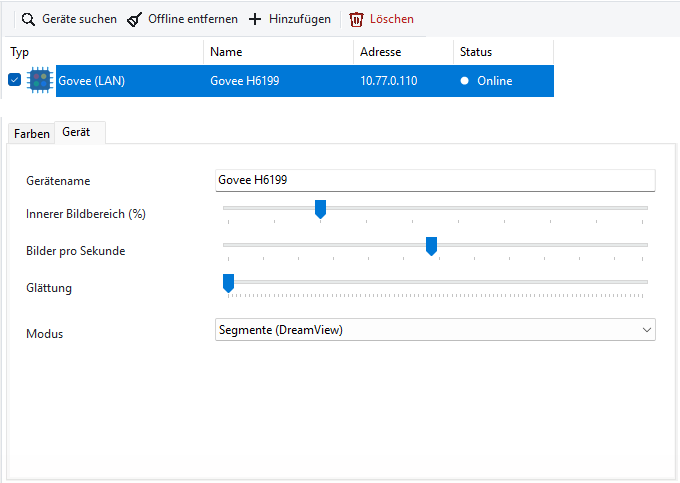

# Govee-Leuchten

[English](../en/govee.md) · **Deutsch** · [Benutzerhandbuch](../benutzerhandbuch.md)

AmbiBack PC kann Govee-WLAN-Leuchten (LED-Streifen, Lichtleisten, TV-Hintergrundbeleuchtungen, Stehlampen) über die **Govee-LAN-API** ansteuern: direkt im Netzwerk, ohne Govee-Cloud und ohne Konto.

## Vorher: LAN-Steuerung einschalten

Die LAN-API ist ab Werk aus. Öffne in der **Govee-Home**-App die Leuchte, tippe auf das Zahnrad für die Einstellungen und schalte **LAN-Steuerung** (*LAN Control*) ein. Nicht jedes Modell bietet das an; ohne diese Einstellung kann AmbiBack PC die Leuchte weder finden noch steuern.

PC und Leuchte müssen im selben Netz sein.

## Govee-Leuchte hinzufügen

**Automatisch:** **Geräte suchen** (`F5`) sucht auch nach Govee-Leuchten mit LAN-Steuerung. Jede Leuchte, die antwortet, erscheint in der Liste als *Govee (LAN)*, benannt nach ihrem Modell (z. B. *Govee H6199*).

**Von Hand:** Klicke auf **Hinzufügen**, gib die IP-Adresse der Leuchte ein und wähle den Gerätetyp **Govee (LAN)**, oder lass *Gerätetyp automatisch erkennen* angehakt. Die Adresse findest du in deinem Router.

Eine Leuchte, die unter einer neuen Adresse wieder gefunden wird, behält ihre Einstellungen (sie wird an ihrer Geräte-ID erkannt).

## Modus wählen

Wähle die Leuchte aus und öffne den Reiter **Gerät**. Dort steht statt der Verbindung die Einstellung *Modus*:




| Modus | Was er macht |
| --- | --- |
| **Segmente (DreamView)** | Standard. Sendet eine Farbe je LED der Anordnung; die Leuchte verteilt sie auf ihre Segmente. Das nutzt das Protokoll hinter Govees DreamView- und Razer-Chroma-Unterstützung, das Govee nicht dokumentiert, und klappt nur bei Modellen mit DreamView. |
| **Einzelfarbe (jedes Modell)** | Sendet die Durchschnittsfarbe des Bildschirms als eine Farbe, höchstens 10-mal pro Sekunde. Klappt bei jeder Leuchte mit LAN-Steuerung. |

Bleibt die Leuchte im Modus *Segmente* bei ihrer eigenen Szene, hat das Modell vermutlich kein DreamView: Wechsle zu *Einzelfarbe*.

## Anordnung einstellen

Im Modus *Segmente* funktioniert die Anordnung wie bei einem [AmbiBack-Controller](ambiback-devices.md#led-anordnung-einstellen):

1. Klicke auf der Monitor-Karte auf **Verwenden** und hake die Govee-Leuchte in der Geräteliste an.
2. Wähle die Leuchte aus. Stelle auf der Monitor-Karte die Zahl der LEDs **vertikal** (eine Seite) und **horizontal** (oben oder unten) ein, dazu Startecke und Richtung.
3. Klicke auf **Starten**.

Eine neue Govee-Leuchte beginnt mit 5 horizontal und 3 vertikal (zusammen 16 Farben). Govee meldet nicht, wie viele Segmente eine Leuchte hat; stelle die Zahlen so ein, dass die Summe zu den Segmenten deiner Leuchte passt, oder zu der Zahl, die die Govee-App für DreamView zeigt. Gesendet werden höchstens 255 Farben.

## Einstellungen

Alle Regler auf den Reitern [„Farben“ und „Gerät“](settings.md) wirken auch für Govee:

- **Bilder pro Sekunde**: standardmäßig 30. Im Modus *Einzelfarbe* werden ohnehin höchstens 10 Farben pro Sekunde gesendet.
- **Glättung**: standardmäßig 0 (aus). Höhere Werte blenden die Farben weicher über; AmbiBack PC erledigt das vor dem Senden.
- **Rot, Grün, Blau**, **Farbverstärkung**, **Helligkeitsverstärkung**, **Maximale Helligkeit** und **Minimale Helligkeit** wendet AmbiBack PC an. Die in der Govee-App eingestellte Helligkeit begrenzt die Leuchte weiterhin.

## Starten und Stoppen

Beim Start schaltet AmbiBack PC die Leuchte ein. Stoppt AmbiBack, geht der Monitor aus oder schläft der PC, kehrt eine Leuchte im Modus *Segmente* zur Szene oder Farbe aus der Govee-App zurück. Im Modus *Einzelfarbe* behält sie die letzte Farbe.

Es kann immer nur ein Programm die Leuchte steuern: Beende DreamView in der Govee-App und andere Programme, die die Leuchte über das LAN steuern.

## Ohne Monitor prüfen

Über die Kommandozeile kannst du ein bewegtes Testbild an eine Leuchte streamen:

```powershell
& "$env:LOCALAPPDATA\Programs\AmbiBack\AmbiBack.exe" --govee-test 192.168.0.43 10
```

Mit `single` am Ende im Modus *Einzelfarbe*. Es zeigt, was die Leuchte über sich meldet (Modell, Geräte-ID, Firmware), und wie viele Bilder pro Sekunde gesendet werden. Stoppe vorher den Monitor, der diese Leuchte ansteuert, damit nur einer sendet.

## Probleme

| Problem | Lösung |
| --- | --- |
| Die Leuchte wird nicht gefunden | Ist *LAN-Steuerung* in der Govee-Home-App eingeschaltet? Ist die Leuchte im selben Netz? Manche Router sperren Multicast zwischen WLAN und LAN; **Hinzufügen** mit IP-Adresse. Eine Firewall muss UDP-Port 4002 hereinlassen. |
| Die Leuchte bleibt bei ihrer eigenen Szene | Im Modus *Segmente*: Das Modell unterstützt DreamView eventuell nicht, wechsle zu *Einzelfarbe*. Beende DreamView in der Govee-App. |
| Farben auf der falschen Seite | Ändere Startecke oder Richtung auf der Monitor-Karte. Prüfe die Zahlen je Seite gegen die Segmente der Leuchte. |
| Die Farben ändern sich träge | Im Modus *Einzelfarbe* bekommt die Leuchte höchstens 10 Farben pro Sekunde. Nutze *Segmente*, wenn das Modell es unterstützt. |
