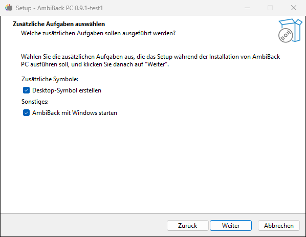

# Installation

[English](../en/installation.md) · **Deutsch** · [Benutzerhandbuch](../benutzerhandbuch.md)

## Was du brauchst

- Windows 10 oder 11.
- Das .NET Framework 4.7.2 oder neuer. Aktuelle Windows-Versionen haben es schon; sonst installiert es das Setup.
- Die Microsoft Edge WebView2 Runtime für die Geräte-Webseiten und die Kalibriervideos. Das Setup installiert sie, wenn sie fehlt.
- PC und Lichtquellen im selben lokalen Netzwerk.
- Für einen AmbiBack-Controller am USB-Anschluss den Treiber seines USB-Chips, falls Windows keinen hat: [FTDI VCP](https://ftdichip.com/drivers/vcp-drivers/) oder [Silicon Labs CP210x](https://www.silabs.com/developers/usb-to-uart-bridge-vcp-drivers).

## Download

Lade die aktuelle Version von der [Release-Seite](https://github.com/ambiback/ambiback-pc/releases/latest). Jedes Release hat zwei Dateien:

| Datei | Nimm sie, wenn |
| --- | --- |
| `AmbiBack-PC-<Version>-setup.exe` | du eine normale Installation mit Startmenü-Eintrag, Autostart und Deinstallation willst. Empfohlen. |
| `AmbiBack-PC-<Version>.zip` | du eine portable Kopie willst, etwa auf einem USB-Stick, oder kein Setup ausführen kannst. |

## Mit dem Setup installieren

1. Starte `AmbiBack-PC-<Version>-setup.exe`.
2. **SmartScreen-Warnung:** Die Dateien sind nicht signiert, daher kann Windows „Der Computer wurde durch Windows geschützt“ anzeigen. Klicke auf **Weitere Informationen** und dann auf **Trotzdem ausführen**.
3. **Installationsart** (nur bei der ersten Installation gefragt): Wähle *Nur für mich installieren* (ohne Administratorrechte, nach `%LOCALAPPDATA%\Programs\AmbiBack`) oder *Für alle Benutzer installieren* (mit Administratorrechten, nach `C:\Program Files\AmbiBack`).
4. Lizenz (GPL 3) akzeptieren.
5. **Zusätzliche Aufgaben:**
   - *AmbiBack mit Windows starten* (vorausgewählt).
   - *Desktop-Symbol erstellen* (bei der ersten Installation nicht vorausgewählt).

   

   Ein Update übernimmt Installationsart und Auswahl der vorigen Installation.
6. Fehlt das .NET Framework, bietet das Setup an, es von Microsoft herunterzuladen (Internet und Administratorrechte nötig). Danach möchte Windows eventuell neu starten.
7. Zum Schluss *AmbiBack PC starten* angehakt lassen.

Das Setup spricht Deutsch oder Englisch, passend zur Windows-Sprache.

## Portable ZIP verwenden

1. Entpacke die Datei in einen Ordner, in den du schreiben darfst, zum Beispiel `D:\Tools\AmbiBack`.
2. Starte `AmbiBack.exe`. Warnt SmartScreen, klicke auf **Weitere Informationen** und dann auf **Trotzdem ausführen**.

Die ZIP-Version installiert weder das .NET Framework noch WebView2. Auf aktuellem Windows ist beides meist vorhanden.

Das Starten einer portablen Kopie ändert den Windows-Autostart nicht. Ist AmbiBack auch installiert, startet Windows weiter die installierte Kopie. Soll stattdessen die portable Kopie mit Windows starten, setze in ihren [Optionen](settings.md) den Haken bei *AmbiBack mit Windows starten*.

## Erster Start

1. AmbiBack sucht im Netzwerk und an den USB-Anschlüssen nach Geräten.
2. Die **Windows-Firewall** fragt eventuell, ob AmbiBack in Netzwerken kommunizieren darf. Erlaube es für **private Netzwerke**. AmbiBack empfängt die Antworten der AmbiBack-Controller auf UDP-Port 1337 und der Govee-Leuchten auf UDP-Port 4002; blockierst du das, findet die Suche keines von beiden. Siehe [Problemlösung › Firewall](troubleshooting.md#windows-firewall).
3. Das Hauptfenster öffnet sich. Weiter mit dem [Schnellstart](quick-start.md).

AmbiBack läuft nur einmal. Ein zweiter Start holt das offene Fenster nach vorne.

## Wo die Einstellungen liegen

Einstellungen und Geräteliste liegen im Programmordner, wenn dieser beschreibbar ist (portable Nutzung und *Nur für mich installieren*), sonst unter `%LOCALAPPDATA%\AmbiBack\PC`.

## Aktualisieren

Starte das Setup der neuen Version. Es beendet ein laufendes AmbiBack, ersetzt die Dateien und startet es wieder. Einstellungen und Geräte bleiben erhalten.

Bei der ZIP-Version entpackst du die neue Version über den alten Ordner.

## Deinstallieren

Öffne in Windows *Einstellungen › Apps › Installierte Apps*, suche **AmbiBack PC** und wähle *Deinstallieren*. Stoppe AmbiBack vorher, damit Hue-Lampen sauber ausgeschaltet werden.
