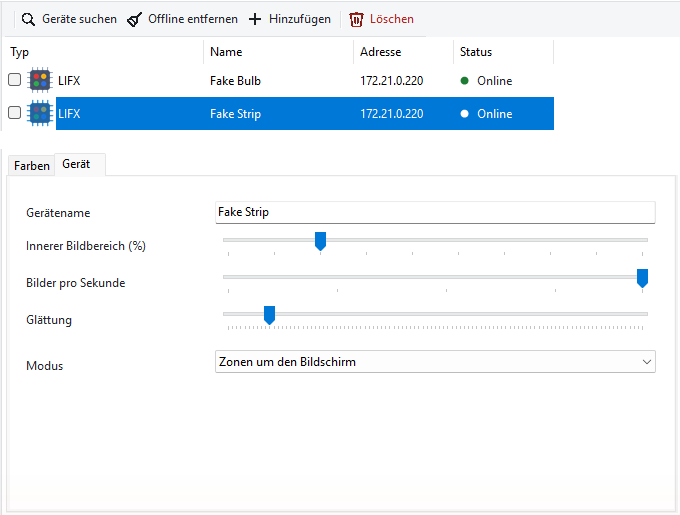

# LIFX-Lampen

[English](../en/lifx.md) · **Deutsch** · [Benutzerhandbuch](../benutzerhandbuch.md)

> **Tester gesucht:** Die LIFX-Unterstützung ist nach der Dokumentation des LAN-Protokolls entstanden und gegen nachgebaute Lampen getestet, noch nicht mit echten. [Melde bitte, wie es mit deinen Lampen und Streifen klappt](network-lights.md#test-melden). Schritt für Schritt für alle Netzwerk-Leuchten: [Netzwerk-Leuchten Schritt für Schritt](network-lights.md).

AmbiBack PC steuert LIFX-Lampen direkt im Netzwerk über das **LIFX-LAN-Protokoll**, ohne LIFX-Cloud und ohne Konto: Glühbirnen, Einbauleuchten, Lichtstreifen (LIFX Z, Lightstrip), Beam und Neon.

## LIFX-Lampen hinzufügen

Richte die Lampe zuerst in der LIFX-App ein, damit sie in deinem WLAN ist.

**Automatisch:** **Geräte suchen** (`F5`) fragt im Netz nach LIFX-Lampen. Jede Lampe, die antwortet, erscheint in der Liste als *LIFX*, mit dem Namen aus der LIFX-App.

**Von Hand:** Klicke auf **Hinzufügen**, wähle den Gerätetyp **LIFX** (oder lass *Gerätetyp automatisch erkennen* angehakt) und gib die IP-Adresse der Lampe ein.

AmbiBack PC findet eine Lampe an ihrer MAC-Adresse wieder, auch unter einer neuen Adresse.

## Lampen und Streifen

| Lampe | Was AmbiBack PC sendet |
| --- | --- |
| **Glühbirnen und andere einfarbige Lampen** | Die Durchschnittsfarbe des Bildschirms. Eine Modus-Einstellung gibt es nicht. |
| **Lampen mit Zonen** (LIFX Z, Lightstrip, Beam, Neon) | Modus **Zonen um den Bildschirm** (Standard): Jede Zone bekommt ihre eigene Farbe, der Streifen läuft wie bei einem [AmbiBack-Controller](ambiback-devices.md#led-anordnung-einstellen) um den Bildschirm (Zonen je Seite, Startecke und Richtung auf der Monitor-Karte). Modus **Eine Farbe auf allen Zonen**: die Durchschnittsfarbe. |

Der Modus steht auf dem Reiter **Gerät**:



Für einen Streifen schlägt AmbiBack PC aus der Zahl der Zonen eine Anordnung vor. Lampen mit einem Raster aus Zonen (Tile, Candle, Ceiling) und Streifen mit alter Firmware bekommen eine Farbe.

## Starten und Stoppen

1. Klicke auf der Monitor-Karte auf **Verwenden** und hake die LIFX-Lampen in der Geräteliste an.
2. Klicke auf **Starten**.

AmbiBack PC schaltet die Lampe ein. Stoppt es, bekommt die Lampe wieder die Farbe und den Ein-/Aus-Zustand von vorher.

## Einstellungen

Alle Regler auf den Reitern [„Farben“ und „Gerät“](settings.md) wirken auch für LIFX:

- **Bilder pro Sekunde**: 20, das ist auch das Höchste, was LIFX je Lampe erlaubt.
- **Glättung**: standardmäßig 100 ms. Die Lampe blendet außerdem innerhalb eines Bildes zur neuen Farbe über.
- **Rot, Grün, Blau**, **Farbverstärkung**, **Helligkeitsverstärkung**, **Maximale Helligkeit** und **Minimale Helligkeit** wendet AmbiBack PC an.

## Ohne Monitor prüfen

Über die Kommandozeile kannst du die LIFX-Lampen auflisten und ein bewegtes Testbild an den ersten Streifen (oder die erste Lampe) streamen:

```powershell
& "$env:LOCALAPPDATA\Programs\AmbiBack\AmbiBack.exe" --lifx-test 10
```

Mit einer IP-Adresse vor den Sekunden nur diese Lampe; mit `single` am Ende eine Farbe.

## Probleme

| Problem | Lösung |
| --- | --- |
| Keine LIFX-Lampe wird gefunden | Ist sie in der LIFX-App eingerichtet und im selben Netz? Manche Router sperren Broadcasts zwischen WLAN und LAN; **Hinzufügen** mit IP-Adresse. LIFX antwortet auf einem beliebigen Port, deshalb muss die Windows-Firewall das Programm AmbiBack selbst zulassen (siehe [Firewall](troubleshooting.md#windows-firewall)), nicht nur einzelne Ports. |
| Ein Streifen zeigt nur eine Farbe | Seine Firmware ist eventuell zu alt für Zonen: Aktualisiere sie in der LIFX-App und klicke dann auf **Geräte suchen**. |
| Farben auf der falschen Seite | Ändere Startecke oder Richtung auf der Monitor-Karte. Prüfe die Zonen je Seite. |
| Die Lampe reagiert verzögert | Schwaches WLAN verzögert die Nachrichten. Senke *Bilder pro Sekunde* etwas. |
