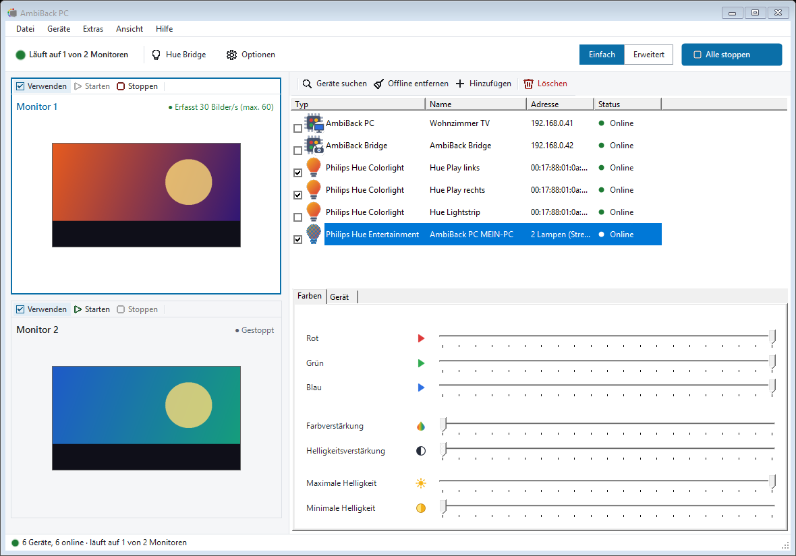

# Das Hauptfenster

[English](../en/main-window.md) · **Deutsch** · [Benutzerhandbuch](../benutzerhandbuch.md)

Das Fenster hat vier Bereiche.

## Toolbar

| Element | Bedeutung |
| --- | --- |
| Statuspunkt und Text | Grün: AmbiBack läuft, mit Anzahl der aktiven Monitore. Grau: gestoppt. |
| **Hue Bridge** | Verbindet die Philips Hue Bridge (siehe [Philips Hue](philips-hue.md)). |
| **Optionen** | Autostart, Sprache, Protokoll (siehe [Optionen](settings.md#optionen)). |
| **Einfach / Erweitert** | Einfach zeigt nur das Nötige. Erweitert zeigt zusätzlich den Reiter *Debug* und die Listenansichten. |
| **Alle starten / Alle stoppen** | Startet oder stoppt das Umgebungslicht auf allen verwendeten Monitoren. |

Alle Toolbar-Befehle gibt es auch im Menü: *Datei* (Alle starten/stoppen, Optionen, Beenden), *Geräte* (Suchen, Hinzufügen, Details, WLAN, Offline entfernen, Löschen), *Extras* (Hue Bridge, Kalibrier- und Demovideos), *Ansicht* und *Hilfe*.

## Monitor-Karten (links)

Eine Karte pro angeschlossenem Monitor mit Live-Vorschau und Status (z. B. „Erfasst 30 Bilder/s“). Siehe [Monitore und Bildbereiche](#monitore-und-bildbereiche) weiter unten.

## Geräteliste (rechts oben)

Alle gefundenen Lichtquellen mit Typ, Name, Adresse und Status (grüner Punkt = online, blauer Punkt = per USB verbunden). Der **Haken** vor einem Gerät ordnet es dem links ausgewählten Monitor zu. Bei Hue-Lampen hat der Haken eine eigene Bedeutung, siehe [Die PC-Gruppe in der Geräteliste](philips-hue.md#die-pc-gruppe-in-der-geräteliste).

## Einstellungen (rechts unten)

Regler für das in der Liste ausgewählte Gerät (siehe [Einstellungen](settings.md)).

Die **Statusleiste** unten zeigt, wie viele Geräte online sind und auf wie vielen Monitoren AmbiBack läuft.

## Monitore und Bildbereiche

Jede Monitor-Karte hat drei Schalter:

| Schalter | Bedeutung |
| --- | --- |
| **Verwenden** | Schaltet die Bildschirmerfassung für diesen Monitor ein. Erst dann lassen sich Geräte starten. |
| **Starten** | Startet das Umgebungslicht für alle Geräte, die diesem Monitor zugeordnet sind. |
| **Stoppen** | Stoppt sie wieder. Hue-Lampen gehen dabei aus. |

**Geräte zuordnen:** Klicke eine Monitor-Karte an (sie bekommt einen blauen Rahmen) und setze in der Geräteliste den Haken bei den Geräten, die zu diesem Monitor gehören. Ein Gerät hängt an einem Monitor, ein Monitor kann mehrere Geräte bedienen.

**Bildbereiche festlegen:** Wähle ein Gerät in der Liste aus. Die ausgewählte Monitor-Karte zeigt dann, welche Bildbereiche es auswertet:

- **AmbiBack-Controller:** Anzahl der LEDs *Vertikal* und *Horizontal* sowie über die Kästchen in den Ecken, wo der LED-Streifen beginnt und in welche Richtung er läuft (die Pfeile zeigen den Verlauf).
- **Hue-Lampe:** zwölf Sektoren am Bildrand (je drei rechts, oben, links und unten). Angehakte Sektoren werden gemittelt. Eine Lampe links neben dem Monitor bekommt also die linken Sektoren. Am einfachsten setzt du sie über den Assistenten [Lampen auswählen](philips-hue.md#schritt-2-lampen-auswählen).
- **Hue-Entertainment-Bereich:** keine Sektoren; die Bereiche ergeben sich aus den Positionen der Lampen im Bereich (siehe [Entertainment-Bereiche aus der Hue-App](philips-hue.md#entertainment-bereiche-aus-der-hue-app)).

Ist ein Monitor aus (Energiesparmodus), pausiert AmbiBack automatisch und schaltet Hue-Lampen aus.

## Kalibrier- und Demovideos

*Extras › Kalibrier- und Demovideos* öffnet eine YouTube-Playlist mit Testvideos für Umgebungslicht. Spiele eines im Vollbild auf dem Monitor ab, um zu prüfen, ob die Lichtquellen die richtigen Farben an den richtigen Stellen zeigen.

## Infobereich (Tray)

Das AmbiBack-Symbol im Infobereich zeigt als Tooltip, ob und auf wie vielen Monitoren AmbiBack läuft. Das Kontextmenü bietet:

- Status
- **Alle Monitore starten** / **Alle Monitore stoppen**
- **AmbiBack anzeigen**
- **Beenden** (schaltet Hue-Lampen vorher aus)

Ist das Symbol versteckt, klicke auf den Pfeil `^` in der Taskleiste. Damit es sichtbar bleibt, ziehe es auf die Taskleiste.
