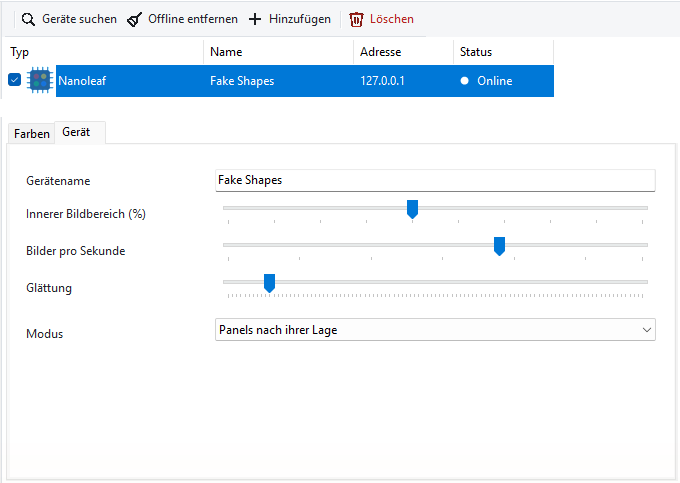

# Nanoleaf-Panels

[English](../en/nanoleaf.md) · **Deutsch** · [Benutzerhandbuch](../benutzerhandbuch.md)

> **Tester gesucht:** Die Nanoleaf-Unterstützung ist nach der Open-API-Dokumentation entstanden und gegen ein nachgebautes Gerät getestet, noch nicht mit echten Panels. Am spannendsten: Zeigen die Panels das Bild an den richtigen Stellen, auch bei gedrehter Anordnung? [Melde bitte, wie es klappt](network-lights.md#test-melden). Schritt für Schritt für alle Netzwerk-Leuchten: [Netzwerk-Leuchten Schritt für Schritt](network-lights.md).

AmbiBack PC steuert Nanoleaf-Panels (Light Panels, Canvas, Shapes, Elements, Lines) direkt im Netzwerk über die **Nanoleaf Open API**, ohne Nanoleaf-App und Cloud. Jedes Panel bekommt die Farbe des Bildbereichs an seiner Stelle in deiner Anordnung.

## Nanoleaf koppeln

Ein Nanoleaf nimmt nur Befehle von Programmen an, die einmal mit ihm gekoppelt wurden:

1. Klicke auf **Hinzufügen**, nimm den Haken bei *Gerätetyp automatisch erkennen* heraus und wähle den Gerätetyp **Nanoleaf**.
2. Gib die IP-Adresse des Nanoleaf ein oder lass das Feld leer: Dann nimmt AmbiBack PC das erste Nanoleaf im Netz, das noch nicht in der Liste steht.
3. Klicke auf **OK**. AmbiBack PC bittet dich, den **Ein-/Aus-Knopf** am Nanoleaf-Controller 5–7 Sekunden gedrückt zu halten, bis die Lichter blinken. Klicke dann innerhalb von 30 Sekunden auf **OK**.

War das Nanoleaf nicht im Kopplungsmodus, sagt AmbiBack PC das; halte den Knopf noch einmal und versuche es erneut.

Das Nanoleaf erscheint mit seinem Namen in der Liste. Den Schlüssel aus der Kopplung speichert AmbiBack PC geschützt für deinen Windows-Benutzer (DPAPI). **Geräte suchen** (`F5`) findet ein gekoppeltes Nanoleaf wieder, auch unter einer neuen Adresse (es wird an seiner Seriennummer erkannt). Gib ihm trotzdem eine feste IP-Adresse im Router.

## Modus wählen

Wähle das Nanoleaf aus und öffne den Reiter **Gerät**. Dort steht statt der Verbindung die Einstellung *Modus*:




| Modus | Was er macht |
| --- | --- |
| **Panels nach ihrer Lage** | Standard. Jedes Panel bekommt die Farbe des Bildbereichs an seiner Stelle in der Anordnung aus der Nanoleaf-App: Panels links zeigen die linke Bildseite, Panels oben den oberen Rand. Die Anordnung ist gedreht wie in der App (*globale Ausrichtung*). |
| **Eine Farbe auf allen Panels** | Jedes Panel bekommt die Durchschnittsfarbe des Bildschirms. |

Die Monitor-Karte zeigt für ein Nanoleaf keine Streifen-Anordnung: Die Lage kommt vom Nanoleaf selbst. Ordnest du die Panels um, liest AmbiBack PC die neue Anordnung beim nächsten Start.

## Starten und Stoppen

1. Klicke auf der Monitor-Karte auf **Verwenden** und hake das Nanoleaf in der Geräteliste an.
2. Klicke auf **Starten**.

AmbiBack PC schaltet das Nanoleaf ein und auf externe Steuerung. Stoppt es, wird der Effekt wieder gewählt, der vorher lief. Wählst du in der Nanoleaf-App einen anderen Effekt, während AmbiBack PC läuft, übernimmt AmbiBack PC innerhalb von 15 Sekunden wieder.

## Einstellungen

Alle Regler auf den Reitern [„Farben“ und „Gerät“](settings.md) wirken auch für Nanoleaf:

- **Bilder pro Sekunde**: standardmäßig 20, bis 30.
- **Glättung**: standardmäßig 100 ms, damit die Panels ruhig wechseln. 0 zeigt jede Änderung sofort.
- **Innerer Bildbereich (%)**: Größe des Bildbereichs um die Stelle jedes Panels (standardmäßig 25 %).
- **Rot, Grün, Blau**, **Farbverstärkung**, **Helligkeitsverstärkung**, **Maximale Helligkeit** und **Minimale Helligkeit** wendet AmbiBack PC an. Die am Nanoleaf eingestellte Helligkeit begrenzt die Panels weiterhin.

## Ohne Monitor prüfen

Über die Kommandozeile kannst du ein Nanoleaf koppeln und ein bewegtes Testbild streamen:

```powershell
& "$env:LOCALAPPDATA\Programs\AmbiBack\AmbiBack.exe" --nanoleaf-test 192.168.0.44 10
```

Ohne Schlüssel wartet es bis zu 30 Sekunden auf den Ein-/Aus-Knopf und gibt den neuen Schlüssel aus; gib ihn beim nächsten Mal nach der Adresse an. Mit `single` am Ende im Modus *Eine Farbe auf allen Panels*.

## Probleme

| Problem | Lösung |
| --- | --- |
| Die Kopplung klappt nicht | Halte den Ein-/Aus-Knopf, bis die Lichter blinken (5–7 Sekunden), und klicke dann innerhalb von 30 Sekunden. Bei Lines und Elements ist es der Knopf am Controller. |
| Das Nanoleaf wird nicht gefunden | Ist es im selben Netz? Gib beim Hinzufügen seine IP-Adresse ein. Manche Router sperren mDNS zwischen WLAN und LAN. |
| Ein gekoppeltes Nanoleaf bleibt offline | Klicke auf **Geräte suchen**. Wurde es zurückgesetzt, lösche es aus der Liste und kopple es neu. |
| Die Panels zeigen die falsche Bildseite | Prüfe Anordnung und Drehung in der Nanoleaf-App; AmbiBack PC übernimmt sie so, wie sie sind. |
| Die Panels bleiben bei ihrem Effekt | Ist das Nanoleaf für den Monitor angehakt und der Monitor gestartet? Ältere Light Panels (Aurora) brauchen für die externe Steuerung Firmware 3.1 oder neuer. |
