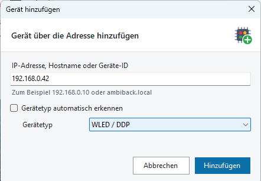
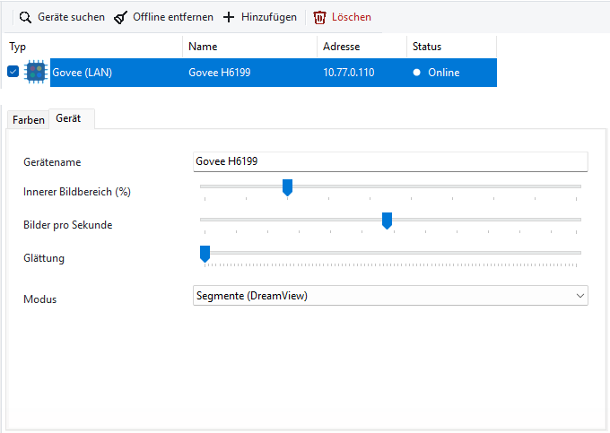
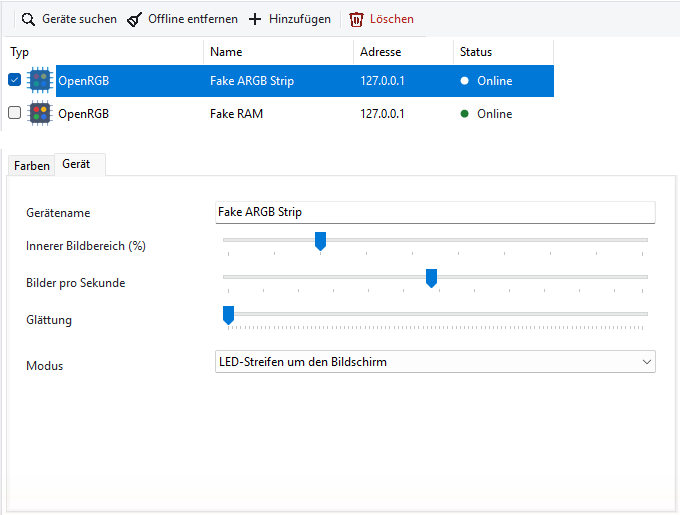
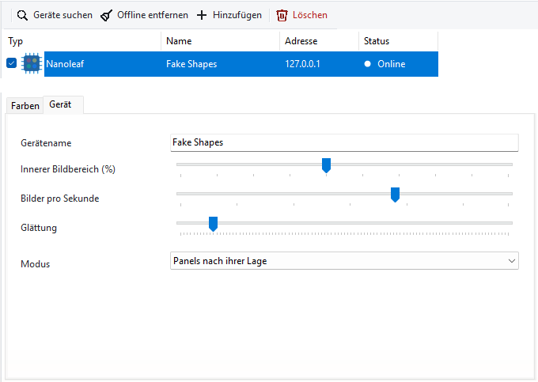
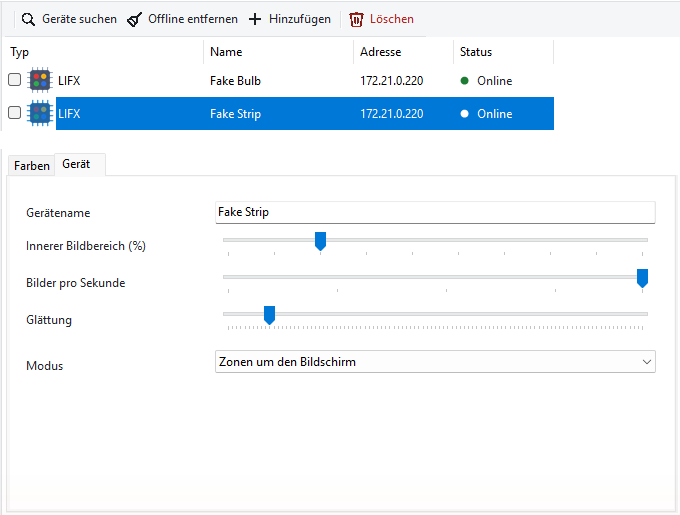
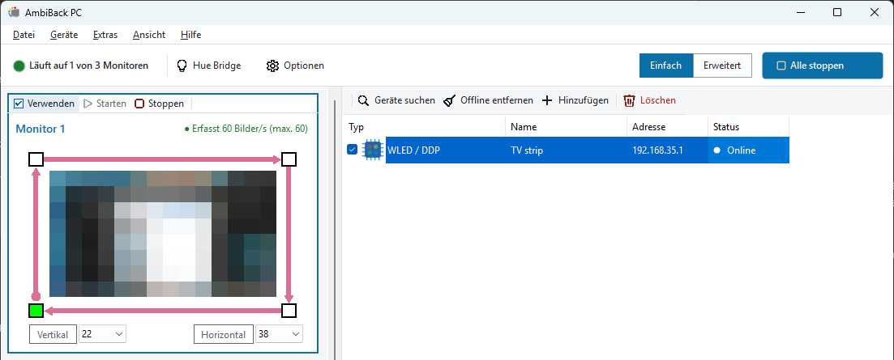

# Netzwerk-Leuchten Schritt für Schritt

[English](../en/network-lights.md) · **Deutsch** · [Benutzerhandbuch](../benutzerhandbuch.md)

Neben AmbiBack-Controllern und Philips Hue steuert AmbiBack PC fünf weitere Arten von Leuchten direkt im Netzwerk: **WLED** (und andere DDP-Streifen), **Govee**, **OpenRGB**, **Nanoleaf** und **LIFX**. Sie funktionieren alle nach demselben Muster. Dieses Tutorial geht es einmal durch, vom Vorbereiten der Leuchte bis zum Stoppen, und zeigt, wo sich die Leuchtentypen unterscheiden.

> ### Tester gesucht
>
> Ich kann nur mit meinen eigenen Geräten testen: **WLED** und **Philips Hue**, vielleicht bald auch **Govee**. **OpenRGB**, **Nanoleaf** und **LIFX** sind nach den veröffentlichten Protokollbeschreibungen entstanden und gegen nachgebaute Geräte getestet, nicht gegen echte.
>
> Wenn du eine dieser Leuchten hast, hilft ein kurzer Test sehr: Geh dieses Tutorial durch und sag mir, was geklappt hat und was nicht. Wie, steht unter [Test melden](#test-melden) am Ende. Danke!

| Leuchte | Mit echten Geräten getestet | Worauf achten |
| --- | --- | --- |
| WLED / DDP | eigene Geräte des Entwicklers | andere DDP-Empfänger (ESPHome, Hyperion, ESPixelStick) |
| Philips Hue | eigene Geräte des Entwicklers | – |
| Govee | vielleicht bald durch den Entwickler | Modus *Segmente* bei DreamView-Modellen, *Einzelfarbe* bei anderen |
| OpenRGB | **Tester gesucht** | Mainboards, Arbeitsspeicher, Lüfter, LED-Streifen, Tastaturen |
| Nanoleaf | **Tester gesucht** | Lage der Panels und die Drehung aus der Nanoleaf-App |
| LIFX | **Tester gesucht** | Glühbirnen, Zonen bei LIFX Z / Lightstrip / Beam / Neon |

## Schritt 1: Leuchte vorbereiten

Jeder Leuchtentyp braucht eine Sache, bevor AmbiBack PC ihn nutzen kann:

| Leuchte | Vorher |
| --- | --- |
| [WLED](wled.md) | Nichts. Der Streifen muss in deinem WLAN sein. |
| [Govee](govee.md) | In der Govee-Home-App für die Leuchte **LAN-Steuerung** einschalten. |
| [OpenRGB](openrgb.md) | OpenRGB starten und auf dem Reiter *SDK Server* auf **Start Server** klicken. |
| [Nanoleaf](nanoleaf.md) | Noch nichts; gekoppelt wird in Schritt 2 mit dem Ein-/Aus-Knopf. |
| [LIFX](lifx.md) | Die Lampe in der LIFX-App einrichten, damit sie in deinem WLAN ist. |

PC und Leuchten müssen im selben Netz sein. Fragt die Windows-Firewall beim ersten Start, erlaube AmbiBack für **private Netzwerke**.

## Schritt 2: Leuchte finden oder hinzufügen

**Automatisch:** AmbiBack PC sucht beim Start; mit **Geräte suchen** (`F5`) suchst du erneut. WLED-, Govee-, OpenRGB- (auf diesem PC) und LIFX-Leuchten erscheinen von selbst in der Geräteliste, mit ihren Namen. Ein grüner Punkt bedeutet online.

**Von Hand:** Wird eine Leuchte nicht gefunden, klicke auf **Hinzufügen** und gib ihre IP-Adresse ein. Die Adresse findest du in deinem Router oder in der App der Leuchte.

- Lass *Gerätetyp automatisch erkennen* angehakt: AmbiBack PC probiert unter dieser Adresse WLED, Govee, OpenRGB und LIFX.
- Oder nimm den Haken heraus und wähle den Typ selbst. Für einen DDP-Empfänger, der kein WLED ist, wähle **WLED / DDP**; für OpenRGB auf einem anderen PC **OpenRGB** (alle seine Geräte werden hinzugefügt).
- **Nanoleaf** fügst du immer so hinzu: wähle **Nanoleaf**, gib seine Adresse ein (oder lass das Feld leer, dann nimmt AmbiBack PC das erste gefundene Nanoleaf), klicke auf **OK**, halte den Ein-/Aus-Knopf 5–7 Sekunden gedrückt, bis die Lichter blinken, und klicke innerhalb von 30 Sekunden noch einmal auf **OK**.

Jede Leuchte wird später an ihrer MAC-Adresse, Seriennummer oder Geräte-ID wiedererkannt, auch wenn der Router ihr eine neue Adresse gibt. Ihre Einstellungen bleiben.

## Schritt 3: Leuchte mit einem Monitor verbinden

1. Klicke auf der Karte des Monitors, zu dem die Leuchte gehört, auf **Verwenden**. Die Karte zeigt eine Live-Vorschau.
2. Klicke auf die Karte, um sie auszuwählen (blauer Rahmen).
3. Hake die Leuchte in der Geräteliste an.
4. Wähle die Leuchte aus (Klick auf ihren Namen). Die Reiter unter der Liste zeigen jetzt ihre Einstellungen.

## Schritt 4: Modus wählen

Öffne den Reiter **Gerät**. Bei Govee, OpenRGB, Nanoleaf und LIFX-Streifen steht dort, wo AmbiBack-Controller ihre Verbindungsart haben, die Einstellung **Modus**:

| Govee | OpenRGB |
| --- | --- |
|  |  |

| Nanoleaf | LIFX |
| --- | --- |
|  |  |

| Leuchte | Modi |
| --- | --- |
| WLED | keine: immer ein Streifen um den Bildschirm |
| Govee | **Segmente (DreamView)**: eine Farbe je Segment, nur bei Modellen mit DreamView · **Einzelfarbe**: klappt bei jedem Modell |
| OpenRGB | **LED-Streifen um den Bildschirm** (Standard bei LED-Streifen) · **Eine Farbe auf allen LEDs** (Standard bei allem anderen) |
| Nanoleaf | **Panels nach ihrer Lage** · **Eine Farbe auf allen Panels** |
| LIFX | Streifen: **Zonen um den Bildschirm** · **Eine Farbe auf allen Zonen**; Glühbirnen: keiner, immer eine Farbe |

Tipp: Fang im Zweifel mit dem Einfarb-Modus an. Er klappt bei jeder Leuchte und zeigt sofort, ob die Verbindung steht.

## Schritt 5: Anordnung einstellen

In einem Streifen-Modus läuft die Leuchte um den Bildschirm. Die Monitor-Karte zeigt die Anordnung:

1. Stelle die Zahl der LEDs (bzw. Segmente oder Zonen) **vertikal** (eine Seite) und **horizontal** (oben oder unten) ein.
2. Wähle mit den Kästchen in den Ecken, wo der Streifen beginnt und in welche Richtung er läuft. Die Pfeile zeigen den Verlauf.
3. Prüfe es mit einem [Kalibriervideo](main-window.md#kalibrier--und-demovideos) (*Extras › Kalibrier- und Demovideos*) im Vollbild: Die Leuchte muss die Farben an den Stellen zeigen, an denen das Video sie zeigt.

Bei WLED, OpenRGB und LIFX-Streifen schlägt AmbiBack PC aus der gemeldeten LED-Zahl eine Anordnung vor. Bei Govee stellst du die Zahlen so ein, dass die Summe zu den Segmenten deiner Leuchte passt.

**Nanoleaf** hat keine Streifen-Anordnung: Jedes Panel nimmt seine Stelle aus der Anordnung in der Nanoleaf-App. In Einfarb-Modi zeigt die Monitor-Karte ebenfalls keine Anordnung.

## Schritt 6: Starten und feinjustieren

Klicke auf der Monitor-Karte auf **Starten** oder in der Toolbar auf **Alle starten**. Die Leuchte folgt jetzt dem Bild.

Feinjustieren auf den Reitern [„Farben“ und „Gerät“](settings.md):

| Leuchte | Bilder pro Sekunde | Glättung |
| --- | --- | --- |
| WLED | 50 (bis 60) | aus |
| Govee | 30 (Einzelfarbe: höchstens 10 Farben pro Sekunde) | aus |
| OpenRGB | 30 (bis 60) | aus |
| Nanoleaf | 20 (bis 30) | 100 ms |
| LIFX | 20 (das Höchste, was LIFX erlaubt) | 100 ms |

- **Farben zu blass oder zu kräftig:** *Farbverstärkung*, *Helligkeitsverstärkung*, die Regler *Rot*, *Grün* und *Blau*.
- **Zu hell:** *Maximale Helligkeit*. Dunkle Szenen zu dunkel: *Minimale Helligkeit*.
- **Flackert oder springt:** *Glättung* erhöhen oder *Bilder pro Sekunde* senken.
- **Farben auf der falschen Seite:** Startecke oder Richtung ändern (Schritt 5).

## Schritt 7: Stoppen

Klicke auf **Stoppen** (oder **Alle stoppen**). Was die Leuchte dann macht:

| Leuchte | Nach dem Stoppen |
| --- | --- |
| WLED | kehrt nach etwa 2,5 Sekunden zu ihrem eigenen Effekt zurück |
| Govee | *Segmente*: zurück zur Szene aus der Govee-App · *Einzelfarbe*: behält die letzte Farbe |
| OpenRGB | behält die letzten Farben; lade dein Profil in OpenRGB, um deine Beleuchtung zurückzubekommen |
| Nanoleaf | der Effekt von vorher wird wieder gewählt |
| LIFX | bekommt Farbe und Ein-/Aus-Zustand von vorher |

Dasselbe passiert, wenn der Monitor ausgeht oder der PC in den Ruhezustand wechselt.

## Test melden

Jede Rückmeldung hilft, auch „funktioniert“. Bitte füll auf GitHub das **[Formular „Gerätetest melden“](https://github.com/ambiback/ambiback-pc/issues/new?template=device-test.yml)** aus (Deutsch oder Englisch; du brauchst ein kostenloses GitHub-Konto). Es fragt nach:

1. **Die Leuchte:** Marke, Modell (z. B. *Nanoleaf Shapes*, *LIFX Z*, *Govee H6199*) und, falls bekannt, die Firmware.
2. **Die Version von AmbiBack PC** (*Hilfe › Über AmbiBack PC*).
3. **Was geklappt hat:** von selbst gefunden? Von Hand hinzugefügt? Welcher Modus? Erscheinen die Farben an der richtigen Stelle? Flüssig oder ruckelig? Nach dem Stoppen wieder normal?
4. **Was nicht geklappt hat**, und was du stattdessen gesehen hast. Ein Foto oder kurzes Video hilft sehr.
5. **Die Ausgabe des Kommandozeilentests**, wenn du ihn ausführen kannst (er läuft ohne Monitor und auch bei geöffnetem AmbiBack PC):

| Leuchte | Befehl (in PowerShell) |
| --- | --- |
| WLED / DDP | `& "$env:LOCALAPPDATA\Programs\AmbiBack\AmbiBack.exe" --wled-test <adresse> 10` |
| Govee | `& "$env:LOCALAPPDATA\Programs\AmbiBack\AmbiBack.exe" --govee-test <adresse> 10` (mit `single` eine Farbe) |
| OpenRGB | `& "$env:LOCALAPPDATA\Programs\AmbiBack\AmbiBack.exe" --openrgb-test localhost 0 10` (die 0 ist die Gerätenummer aus der ausgegebenen Liste) |
| Nanoleaf | `& "$env:LOCALAPPDATA\Programs\AmbiBack\AmbiBack.exe" --nanoleaf-test <adresse> 10` (koppelt zuerst: Ein-/Aus-Knopf halten) |
| LIFX | `& "$env:LOCALAPPDATA\Programs\AmbiBack\AmbiBack.exe" --lifx-test 10` |

Der Test streamt für die angegebenen Sekunden ein langsam drehendes Farbrad. Bei einem Streifen um den Bildschirm sollten die Farben alle 5 Sekunden einmal herumlaufen. Stoppe vorher den Monitor, der dieselbe Leuchte ansteuert, damit nur ein Programm sendet. Der Nanoleaf-Test gibt einen Auth-Token aus; lass ihn aus deiner Meldung weg.

Details zu jeder Leuchte: [WLED](wled.md) · [Govee](govee.md) · [OpenRGB](openrgb.md) · [Nanoleaf](nanoleaf.md) · [LIFX](lifx.md) · [Problemlösung](troubleshooting.md)
