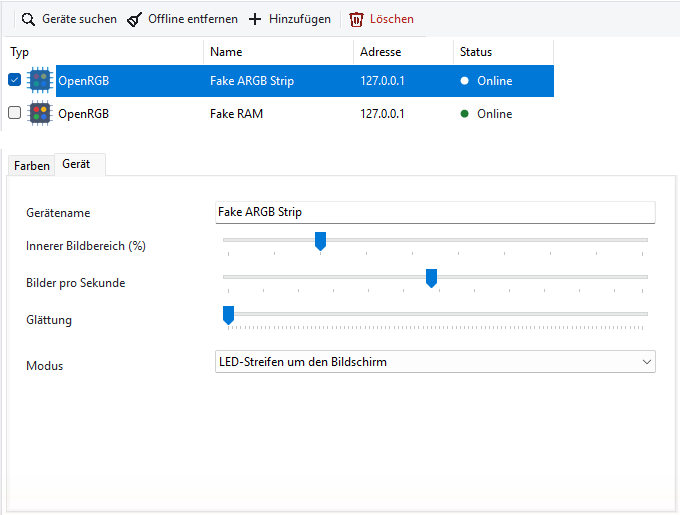

# OpenRGB-Geräte

[English](../en/openrgb.md) · **Deutsch** · [Benutzerhandbuch](../benutzerhandbuch.md)

> **Tester gesucht:** Die OpenRGB-Unterstützung ist nach der offiziellen SDK-Dokumentation entstanden und gegen einen nachgebauten SDK-Server getestet, noch nicht mit echter Hardware. Wenn du OpenRGB nutzt, [melde bitte, wie es mit deinen Geräten klappt](network-lights.md#test-melden). Schritt für Schritt für alle Netzwerk-Leuchten: [Netzwerk-Leuchten Schritt für Schritt](network-lights.md).

[OpenRGB](https://openrgb.org/) steuert die RGB-Beleuchtung vieler PC-Teile und Peripheriegeräte aus einem Programm: Mainboards und ihre ARGB-Anschlüsse, Arbeitsspeicher, Grafikkarten, Lüfter und Kühler, LED-Streifen, Tastaturen, Mäuse und mehr. AmbiBack PC spricht über den **SDK-Server** mit OpenRGB und kann jedes Gerät ansteuern, das OpenRGB kennt.

## Vorher: SDK-Server starten

1. Installiere und starte OpenRGB und prüfe, ob es deine Geräte anzeigt.
2. Öffne den Reiter **SDK Server** und klicke auf **Start Server** (Port 6742).
   Damit er immer läuft, starte OpenRGB mit `--server` oder hake in den Einstellungen von OpenRGB den automatischen Start des Servers an.

OpenRGB muss laufen, solange AmbiBack PC seine Geräte nutzt.

## OpenRGB-Geräte hinzufügen

**Automatisch:** **Geräte suchen** (`F5`) fragt den OpenRGB-SDK-Server auf diesem PC. Jedes OpenRGB-Gerät erscheint in der Liste als *OpenRGB*, mit dem Namen, den OpenRGB ihm gibt.

**Von Hand:** Klicke auf **Hinzufügen**, wähle den Gerätetyp **OpenRGB** und gib die Adresse des PCs ein, auf dem OpenRGB läuft (`localhost` für diesen PC). Alle Geräte dieses OpenRGB werden hinzugefügt. So bindest du auch ein OpenRGB auf einem anderen PC ein.

AmbiBack PC findet ein Gerät an seinem Namen und Ort wieder, auch wenn OpenRGB die Geräte in anderer Reihenfolge auflistet.

## Modus wählen

Wähle das Gerät aus und öffne den Reiter **Gerät**. Dort steht statt der Verbindung die Einstellung *Modus*:



| Modus | Was er macht |
| --- | --- |
| **LED-Streifen um den Bildschirm** | Die LEDs des Geräts laufen in der Reihenfolge von OpenRGB um den Bildschirm. Die Anordnung stellst du wie bei einem [AmbiBack-Controller](ambiback-devices.md#led-anordnung-einstellen) ein: LEDs je Seite, Startecke und Richtung auf der Monitor-Karte. LED-Streifen starten in diesem Modus. |
| **Eine Farbe auf allen LEDs** | Jede LED bekommt die Durchschnittsfarbe des Bildschirms. Für Lüfter, Arbeitsspeicher, Tastaturen, Gehäusebeleuchtung und alles, was nicht um den Bildschirm sitzt. Alle anderen Geräte starten in diesem Modus. |

Für ein von OpenRGB gemeldetes Gerät schlägt AmbiBack PC aus der LED-Anzahl eine Anordnung für einen 16:9-Bildschirm vor. LEDs jenseits der Anordnung bleiben dunkel. Hat das Gerät mehrere Zonen (siehe Details in der Liste), folgt der Streifen der Reihenfolge der Zonen in OpenRGB.

## Starten und Stoppen

1. Klicke auf der Monitor-Karte auf **Verwenden** und hake die OpenRGB-Geräte in der Geräteliste an.
2. Klicke auf **Starten**.

AmbiBack PC schaltet das Gerät in den Direktmodus von OpenRGB und sendet mit jedem Bild alle LED-Farben. Nach dem Stoppen behält das Gerät die letzten Farben; deine gewohnte Beleuchtung bekommst du zurück, indem du dein Profil in OpenRGB lädst.

Es sollte immer nur ein Programm die Farben setzen: Beende in OpenRGB Effekte und andere Werkzeuge für diese Geräte.

## Einstellungen

Alle Regler auf den Reitern [„Farben“ und „Gerät“](settings.md) wirken auch für OpenRGB:

- **Bilder pro Sekunde**: standardmäßig 30, bis 60. Manche Geräte (z. B. am Mainboard-Bus) sind langsamer; senke den Wert, wenn die Farben hinterherhinken.
- **Glättung**: standardmäßig 0 (aus). AmbiBack PC blendet die Farben vor dem Senden über.
- **Rot, Grün, Blau**, **Farbverstärkung**, **Helligkeitsverstärkung**, **Maximale Helligkeit** und **Minimale Helligkeit** wendet AmbiBack PC an.

## Ohne Monitor prüfen

Über die Kommandozeile kannst du die Geräte eines OpenRGB auflisten und ein bewegtes Testbild an eines davon streamen:

```powershell
& "$env:LOCALAPPDATA\Programs\AmbiBack\AmbiBack.exe" --openrgb-test localhost 0 10
```

Die Argumente sind die Adresse, die Gerätenummer aus der ausgegebenen Liste und die Sekunden; mit `single` am Ende im Modus *Eine Farbe auf allen LEDs*.

## Probleme

| Problem | Lösung |
| --- | --- |
| Kein OpenRGB-Gerät wird gefunden | Läuft OpenRGB und ist der SDK-Server gestartet (Reiter *SDK Server*, *Start Server*)? Zeigt OpenRGB selbst die Geräte an? |
| Ein OpenRGB auf einem anderen PC wird nicht gefunden | **Hinzufügen** mit Adresse. Auf jenem PC muss die Windows-Firewall OpenRGB Verbindungen auf TCP-Port 6742 annehmen lassen. |
| Ein Gerät bleibt nach einem Neustart von OpenRGB offline | Klicke auf **Geräte suchen**. Hat OpenRGB das Gerät umbenannt, füge es neu hinzu und lösche den alten Eintrag. |
| Farben flackern oder kämpfen mit einem Effekt | Beende in OpenRGB Effekte für dieses Gerät und schließe andere RGB-Programme (Herstellersoftware), die es steuern. |
| Farben an der falschen Stelle | Im Modus *LED-Streifen*: Ändere Startecke, Richtung oder die LEDs je Seite. Für Geräte, die nicht um den Bildschirm sitzen, nimm *Eine Farbe auf allen LEDs*. |
