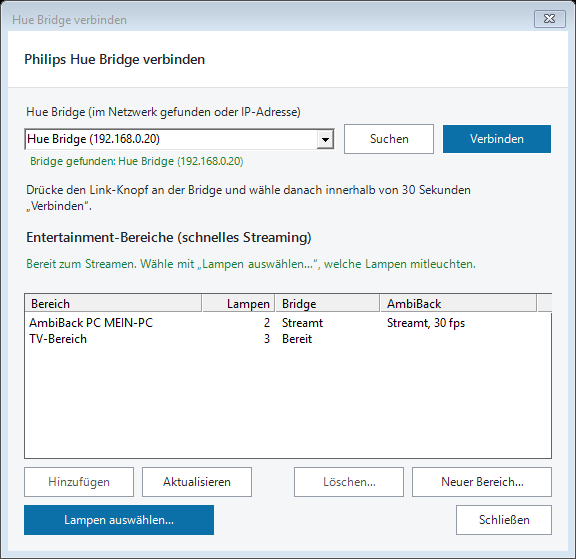
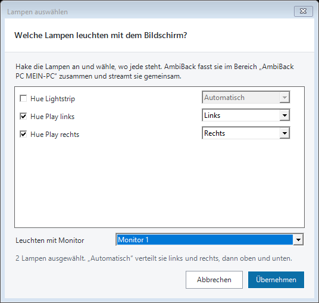
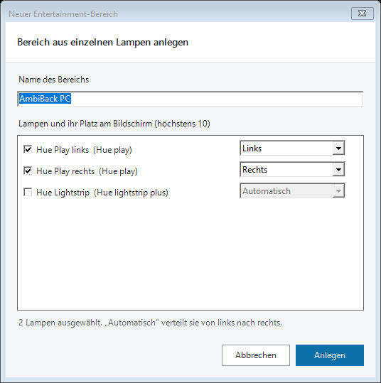

# Philips Hue

[English](../en/philips-hue.md) · **Deutsch** · [Benutzerhandbuch](../benutzerhandbuch.md)

## So funktioniert es

AmbiBack steuert Hue-Lampen ausschließlich über die **Hue Entertainment API**: Die Farben aller Lampen gehen verschlüsselt (DTLS) 25 bis 50 Mal pro Sekunde in einem Datenstrom an die Bridge, die sie synchron an die Lampen weitergibt. Das ist derselbe Weg, den die Hue-App für „Sync“ nutzt. Einzelne Farbbefehle über HTTP, die langsam sind und die Bridge überlasten, verwendet AmbiBack nicht.

Gestreamt wird immer an einen **Entertainment-Bereich** der Bridge. AmbiBack legt dafür einen eigenen Bereich an, **„AmbiBack PC <Rechnername>“**, und hält ihn mit deiner Lampenauswahl aktuell. Alternativ kannst du einen Bereich verwenden, den du in der Hue-App eingerichtet hast.

**Du brauchst** eine Hue Bridge der zweiten Generation (eckig) mit aktueller Firmware und Farblampen, die Entertainment unterstützen. Steckdosen und reine Weißlampen werden nicht angezeigt.

## Schritt 1: Bridge verbinden

Klicke in der Toolbar auf **Hue Bridge**.

1. **Bridge wählen:** Beim ersten Öffnen sucht AmbiBack die Bridge automatisch und trägt sie ein („Bridge gefunden: …“). Hast du mehrere Bridges, klappt die Liste auf und du wählst eine aus. **Suchen** sucht erneut. Du kannst auch eine IP-Adresse von Hand eingeben.
2. **Link-Knopf drücken:** Drücke den runden Knopf oben auf der Bridge.
3. **Verbinden:** Klicke innerhalb von 30 Sekunden auf **Verbinden**. AmbiBack meldet sich an der Bridge an und erhält dabei den Schlüssel für das Streaming.
4. Danach öffnet sich automatisch der Assistent **Lampen auswählen**.

Die Statuszeile unter „Entertainment-Bereiche“ zeigt den Stand: *Nicht verbunden*, *ohne Streaming-Schlüssel* (dann Link-Knopf drücken und erneut verbinden) oder *Bereit zum Streamen*.

Die Liste zeigt alle Entertainment-Bereiche der Bridge mit der Anzahl der Lampen, ihrem Zustand auf der Bridge (*Streamt* / *Bereit*) und dem Zustand in AmbiBack (z. B. *Streamt, 30 fps*).

Du verbindest nur einmal. AmbiBack merkt sich die Bridge und ihren Schlüssel.

## Schritt 2: Lampen auswählen

Der Assistent erscheint nach dem Verbinden und jederzeit über **Lampen auswählen…** im Hue-Dialog.

1. **Lampen anhaken**, die mit dem Bildschirm leuchten sollen (höchstens 10, eine Grenze der Bridge).
2. **Platz wählen**, an dem jede Lampe steht: *Links*, *Rechts*, *Oben*, *Unten* oder eine Ecke. *Automatisch* verteilt die Lampen links und rechts, dann oben und unten. Daraus ergeben sich die Bildbereiche, die jede Lampe auswertet.
3. **Monitor wählen**, mit dem die Lampen leuchten.
4. **Übernehmen**: AmbiBack legt den Bereich „AmbiBack PC <Rechnername>“ an oder passt ihn an und ordnet ihn dem Monitor zu. Läuft der Monitor schon, leuchten die Lampen sofort.

## Schritt 3: Starten

Achte darauf, dass auf der Monitor-Karte **Verwenden** eingeschaltet ist, und klicke dann auf der Karte auf **Starten** (oder **Alle starten**). Die Lampen gehen an und folgen dem Bild.

## Die PC-Gruppe in der Geräteliste

Nach dem Assistenten stehen in der Geräteliste:

- **Philips Hue Entertainment „AmbiBack PC <Rechnername>“**: die Gruppe. **Nur sie wird einem Monitor zugeordnet und gestartet.** Sie streamt alle ihre Lampen gemeinsam.
- **Philips Hue Colorlight**: die einzelnen Lampen. Ihr **Haken bedeutet „gehört zur Gruppe“**, unabhängig vom ausgewählten Monitor. Hakst du eine Lampe an oder ab, passt AmbiBack die Gruppe auf der Bridge an, auch während des Betriebs; herausgenommene Lampen gehen aus. Wählst du eine Lampe aus, kannst du ihre Sektoren auf der Monitor-Karte und eigene Farbregler einstellen.

Einzelne Lampen senden nie selbst. Hast du keine Lampe angehakt, zeigt die Gruppe *Keine Lampen in der Gruppe*.

Beim **Stoppen**, bei **Monitor aus** und beim **Beenden** der App schaltet AmbiBack die Lampen aus. Beim Start schaltet es sie wieder ein.

## Entertainment-Bereiche aus der Hue-App

Du kannst auch einen Bereich verwenden, den du in der Hue-App (*Einstellungen › Entertainment-Bereiche*) eingerichtet hast: Bereich in der Liste auswählen und **Hinzufügen** (oder Doppelklick). Er erscheint als eigenes Gerät, das du einem Monitor zuordnest. Jede Lampe bekommt den Bildbereich an ihrer Position im Bereich (links/rechts und Höhe). Haben die Lampen keine Position, verteilt AmbiBack sie von links nach rechts. Die Größe der Bildbereiche stellst du mit *Innerer Bildbereich (%)* ein.

Die Bridge streamt immer nur **einen** Bereich gleichzeitig. Verwende für dieselben Lampen also entweder die PC-Gruppe oder einen Bereich aus der Hue-App.

## Bereiche anlegen und löschen

**Neuer Bereich…** legt einen zusätzlichen Bereich aus frei gewählten Lampen und Plätzen an, zum Beispiel für einen zweiten Monitor:

**Löschen…** entfernt die markierten Bereiche nach einer Rückfrage von der Bridge. Die Lampen selbst bleiben erhalten. Das ist nötig, wenn die Bridge voll ist: Sie verwaltet **höchstens 20 Entertainment-Bereiche**.

## Netzwerk

AmbiBack spricht mit der Bridge über HTTPS (TCP 443) und streamt über DTLS (UDP 2100). Beides sind ausgehende Verbindungen, die die Windows-Firewall standardmäßig erlaubt. Bei Hue-Problemen: siehe [Problemlösung › Philips Hue](troubleshooting.md#philips-hue).
