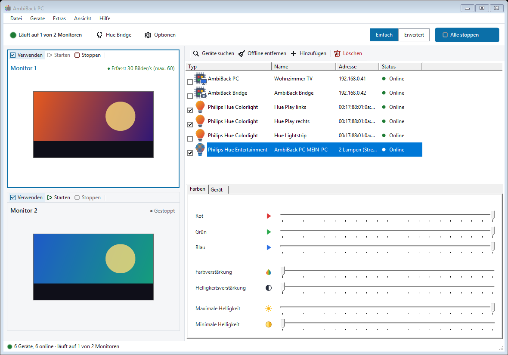

# Schnellstart

[English](../en/quick-start.md) · **Deutsch** · [Benutzerhandbuch](../benutzerhandbuch.md)

Vom Download zum Licht an der Wand in wenigen Minuten.

## 1. Installieren

Lade `AmbiBack-PC-<Version>-setup.exe` von der [Release-Seite](https://github.com/ambiback/ambiback-pc/releases/latest) und starte es. Warnt SmartScreen, klicke auf **Weitere Informationen › Trotzdem ausführen**. Details: [Installation](installation.md).

## 2. Starten und Firewall erlauben

Erlaube AmbiBack beim ersten Start für **private Netzwerke**, wenn die Windows-Firewall fragt. AmbiBack sucht danach selbst nach Geräten.

## 3. Lichtquellen hinzufügen

Mach den Teil, der zu deinen Lichtquellen passt:

- **AmbiBack-Controller (LED-Streifen):** Er erscheint nach der Suche in der Geräteliste (grüner Punkt = online). Wenn nicht, klicke auf **Hinzufügen** und gib seine IP-Adresse ein. Ein neuer Controller ohne WLAN: per USB anschließen und **Mit WLAN verbinden…** verwenden. Details: [AmbiBack-Geräte](ambiback-devices.md).
- **Philips Hue:** Klicke auf **Hue Bridge**, drücke den Link-Knopf an der Bridge, klicke innerhalb von 30 Sekunden auf **Verbinden**, hake dann unter **Lampen auswählen** deine Lampen und ihre Plätze an und klicke auf **Übernehmen**. Details: [Philips Hue](philips-hue.md).
- **WLED, Govee, OpenRGB, Nanoleaf oder LIFX:** Leuchte vorbereiten (z. B. LAN-Steuerung bei Govee, SDK-Server bei OpenRGB), dann wird sie von selbst gefunden oder mit **Hinzufügen** hinzugefügt; ein Nanoleaf wird mit seinem Ein-/Aus-Knopf gekoppelt. Details: [Netzwerk-Leuchten Schritt für Schritt](network-lights.md).

## 4. Lichtquellen und Monitor verbinden

1. Klicke auf der Karte des Monitors, zu dem die Lichtquellen gehören, auf **Verwenden**. Die Karte zeigt jetzt eine Live-Vorschau.
2. Klicke die Karte an, um sie auszuwählen (blauer Rahmen).
3. Hake in der Geräteliste die Geräte an, die zu diesem Monitor gehören. Bei Hue ist das die Gruppe **Philips Hue Entertainment „AmbiBack PC <Rechnername>“**; das hat der Assistent *Lampen auswählen* schon erledigt.

## 5. Starten

Klicke auf der Monitor-Karte auf **Starten** oder in der Toolbar auf **Alle starten**. Die Lichtquellen folgen jetzt dem Bild.

## 6. Feinabstimmung

- Bei einem LED-Streifen wählst du den Controller aus und stellst auf der Monitor-Karte die Anzahl der LEDs und den Anfang des Streifens ein ([Monitore und Bildbereiche](main-window.md#monitore-und-bildbereiche)).
- Helligkeit und Farbe passt du mit den Reglern an ([Einstellungen](settings.md)).
- Unter [Optionen](settings.md#optionen) legst du fest, ob AmbiBack mit Windows startet und sich im Infobereich versteckt.

Klappt etwas nicht? Siehe [Problemlösung](troubleshooting.md).
