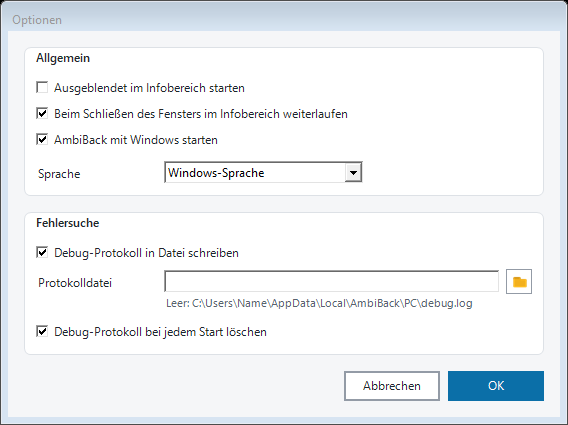

# Einstellungen und Optionen

[English](../en/settings.md) · **Deutsch** · [Benutzerhandbuch](../benutzerhandbuch.md)

## Geräteeinstellungen

Die Regler rechts unten gelten für das in der Liste ausgewählte Gerät und wirken sofort.

### Reiter „Farben“

| Regler | Wirkung |
| --- | --- |
| Rot, Grün, Blau | Anteil der jeweiligen Farbe in Prozent, z. B. um einen Farbstich der LEDs oder der Wand auszugleichen. |
| Farbverstärkung | Hebt die vorherrschende Farbe hervor und dämpft die anderen; macht das Licht satter. |
| Helligkeitsverstärkung | Hellt dunkle Bilder auf (über 100 %). |
| Maximale Helligkeit | Obergrenze der Helligkeit. |
| Minimale Helligkeit | Untergrenze, damit es bei dunklen Szenen nicht ganz dunkel wird. |

### Reiter „Gerät“

| Einstellung | Wirkung |
| --- | --- |
| Gerätename | Name des Geräts, sofern das Gerät eine Umbenennung unterstützt. |
| Verbindung | *UDP* funktioniert in jedem WLAN und ist Standard; *TCP* braucht ein stabiles WLAN; *USB* für direkt angeschlossene Controller. Bei einer Govee-Leuchte steht hier *Modus*: [Segmente oder Einzelfarbe](govee.md#modus-wählen), bei einem OpenRGB-Gerät [Streifen oder eine Farbe](openrgb.md#modus-wählen), bei einem Nanoleaf [Panels nach ihrer Lage oder eine Farbe](nanoleaf.md#modus-wählen). |
| Bilder pro Sekunde | Wie oft Farben gesendet werden. Hue-Streaming: 25 bis 50. WLED/DDP: bis 60. Govee und OpenRGB: standardmäßig 30. Nanoleaf: 20, bis 30. |
| Glättung | Übergangszeit zwischen Farben (nicht bei Hue; die Bridge glättet selbst). Bei WLED/DDP, Govee, OpenRGB und Nanoleaf glättet AmbiBack PC vor dem Senden (Nanoleaf: standardmäßig 100 ms). |
| Innerer Bildbereich (%) | Wie weit die Bildbereiche ins Bild hineinreichen. Bei Hue-Bereichen und Nanoleaf: Größe des Bereichs um jede Lampe bzw. jedes Panel. |

### Reiter „Debug“

Im Modus *Erweitert* erscheint bei Controllern mit Debug-Unterstützung zusätzlich der Reiter **Debug** (Syslog-Ausgabe, Geräteinfo, Neustart).

## Optionen

Klicke in der Toolbar auf **Optionen**.

| Option | Bedeutung |
| --- | --- |
| Ausgeblendet im Infobereich starten | Das Fenster bleibt beim Start verborgen; AmbiBack läuft im Infobereich. |
| Beim Schließen des Fensters im Infobereich weiterlaufen | Das Schließen-Kreuz blendet das Fenster nur aus. Beenden über *Datei › Beenden* oder das Tray-Menü. |
| AmbiBack mit Windows starten | Trägt diese Kopie von AmbiBack in den Windows-Autostart ein. Die Zeile darunter zeigt, welches Programm Windows derzeit startet. Ist es eine andere Kopie, setze den Haken, um stattdessen diese Kopie zu starten. |
| Sprache | Deutsch, Englisch oder die Windows-Sprache. |
| Debug-Protokoll | Schreibt ein Protokoll zur Fehlersuche; leer = Standardpfad. Hue-Schlüssel werden nie protokolliert. |

**Tipp:** Für ein Umgebungslicht, das einfach immer da ist, hake alle drei an: mit Windows starten, ausgeblendet starten, beim Schließen weiterlaufen. Klicke dann einmal auf **Alle starten**; AmbiBack merkt sich, welche Monitore laufen.
