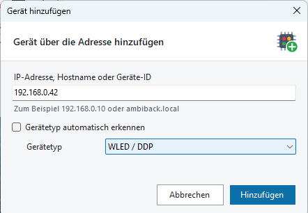
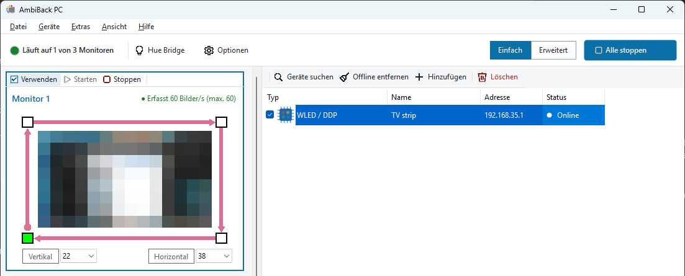

# WLED und andere DDP-Empfänger

[English](../en/wled.md) · **Deutsch** · [Benutzerhandbuch](../benutzerhandbuch.md)

AmbiBack PC kann einen LED-Streifen mit [WLED](https://kno.wled.ge/)-Firmware ansteuern und auch jeden anderen Empfänger des **DDP**-Protokolls (Distributed Display Protocol, UDP-Port 4048), zum Beispiel ESPHome, Hyperion oder ESPixelStick. WLED läuft auf günstigen ESP8266/ESP32-Boards, und viele Streifen für Smart-Home-Apps lassen sich damit neu bespielen.

AmbiBack PC berechnet die Farbe jeder LED selbst und sendet die fertigen Werte. Anordnung, Farbregler und Glättung stellst du in AmbiBack PC ein, nicht in WLED.

## WLED-Gerät hinzufügen

**Automatisch:** **Geräte suchen** (`F5`) fragt im Netz auch nach WLED-Geräten (mDNS, `_wled._tcp`). Jedes WLED, das antwortet, erscheint in der Liste als *WLED / DDP*, mit dem Namen und der LED-Anzahl, die es meldet.

**Von Hand:** Klicke auf **Hinzufügen** und gib die IP-Adresse oder den Hostnamen ein (z. B. `wled-tv.local`).



- Ist *Gerätetyp automatisch erkennen* angehakt, fragt AmbiBack die Adresse nach WLED (`/json/info`) und fügt sie als WLED hinzu, wenn sie antwortet.
- Für einen DDP-Empfänger, der kein WLED ist, nimm den Haken heraus und wähle den Gerätetyp **WLED / DDP**.

Tipp: Gib dem Gerät im Router eine feste IP-Adresse. Ein WLED, das unter einer neuen Adresse wieder gefunden wird, behält seine Einstellungen (es wird an seiner MAC-Adresse erkannt).

## LED-Anordnung einstellen

Die Anordnung funktioniert wie bei einem [AmbiBack-Controller](ambiback-devices.md#led-anordnung-einstellen):

1. Klicke auf der Monitor-Karte auf **Verwenden** und hake das WLED-Gerät in der Geräteliste an.
2. Wähle das Gerät aus. Stelle auf der Monitor-Karte die Zahl der LEDs **vertikal** (eine Seite) und **horizontal** (oben oder unten) ein, dazu Startecke und Richtung.
3. Klicke auf **Starten**.



Für ein im Netz gefundenes WLED schlägt AmbiBack aus der LED-Anzahl eine Anordnung für einen 16:9-Bildschirm vor. Prüfe sie an deinem Streifen: Die Zahl je Seite muss zu den LEDs passen, die wirklich auf dieser Seite sitzen. Die Anordnung umfasst höchstens 120 LEDs horizontal und 60 vertikal.

## Einstellungen

Alle Regler auf den Reitern [„Farben“ und „Gerät“](settings.md) wirken auch für WLED (die Einstellung *Verbindung* gibt es hier nicht, DDP nutzt immer UDP):

- **Bilder pro Sekunde**: standardmäßig 50, bis 60.
- **Glättung**: standardmäßig 0 (aus). Höhere Werte blenden die Farben weicher über; AmbiBack PC erledigt das vor dem Senden.
- **Rot, Grün, Blau**, **Farbverstärkung**, **Helligkeitsverstärkung**, **Maximale Helligkeit** und **Minimale Helligkeit** wendet AmbiBack PC an. Lass die Helligkeit in WLED auf 100 % und begrenze sie hier, oder stelle in WLED eine Strombegrenzung für das Netzteil ein.

## Was WLED dabei macht

WLED schaltet in den Live-Modus, sobald das erste Bild ankommt (die WLED-Webseite zeigt *live*). Stoppt AmbiBack, geht der Monitor aus oder schläft der PC, kehrt WLED nach etwa 2,5 Sekunden zu seinem eigenen Effekt zurück.

## Ohne Monitor prüfen

Über die Kommandozeile kannst du ein bewegtes Testbild an ein Gerät streamen:

```powershell
& "$env:LOCALAPPDATA\Programs\AmbiBack\AmbiBack.exe" --wled-test 192.168.0.42 10
```

Es zeigt, was WLED über sich meldet, welche Anordnung verwendet wird und wie viele Bilder pro Sekunde gesendet werden. Es läuft auch bei geöffnetem AmbiBack PC; stoppe vorher den Monitor, der dieses Gerät ansteuert, damit nur einer sendet.

## Probleme

| Problem | Lösung |
| --- | --- |
| Ein WLED wird nicht gefunden | Ist es im selben Netz? Manche Router sperren mDNS zwischen WLAN und LAN. **Hinzufügen** mit IP-Adresse. |
| Der Streifen bleibt dunkel oder zeigt seinen Effekt | Ist das Gerät für den Monitor angehakt und der Monitor gestartet? Prüfe in WLED unter *Config › Sync Interfaces › Realtime*, dass *Receive UDP realtime* eingeschaltet ist. |
| Farben auf der falschen Seite | Ändere Startecke oder Richtung auf der Monitor-Karte. Prüfe die LED-Zahlen je Seite. |
| Nur ein Teil des Streifens leuchtet | Die Anordnung hat weniger LEDs als der Streifen. Erhöhe die Zahlen je Seite oder kürze die LED-Anzahl in WLED. |
| Der Streifen flackert | Senke *Bilder pro Sekunde* oder erhöhe *Glättung*. Schwaches WLAN verliert Bilder; stelle den Controller näher an den Router. |
