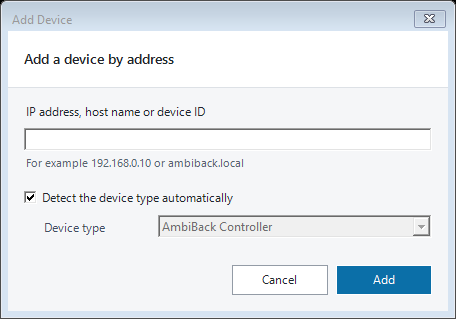

# AmbiBack devices

**English** · [Deutsch](../de/ambiback-devices.md) · [User guide](../user-guide.md)

An AmbiBack controller drives an LED strip behind the monitor. It runs the [AmbiBack firmware](https://github.com/ambiback/ambiback-firmware) and is reached over Wi-Fi (UDP port 1337) or USB.

## Put a new controller on Wi-Fi

A controller that has never been on your Wi-Fi gets its Wi-Fi settings over USB:

1. Connect the controller to the PC with a USB cable. If Windows does not recognize it, install the driver of its USB chip ([FTDI VCP](https://ftdichip.com/drivers/vcp-drivers/) or [Silicon Labs CP210x](https://www.silabs.com/developers/usb-to-uart-bridge-vcp-drivers)).
2. Click **Find Devices** (`F5`). The controller appears with a blue dot (connected over USB).
3. Right-click it and choose **Connect to Wi-Fi…** (also in the *Devices* menu).
4. Enter the **network name (SSID)** and the **password**, then **OK**.
5. The controller restarts and joins the network. Click **Find Devices** again; it now appears with a green dot.

The controller supports 2.4 GHz Wi-Fi only.

## Find devices

**Find Devices** (or `F5`) sends a search into the local network and asks the USB ports. AmbiBack controllers that answer appear in the list. The search also runs on start.

The answers arrive on UDP port 1337. If nothing is found although the controller is on, check the [firewall](troubleshooting.md#windows-firewall).

## Add a device by hand

If the search does not find a device (for example in another network segment), use **Add**:

1. Enter the IP address, host name (e.g. `ambiback.local`) or device ID.
2. Keep *Detect the device type automatically* ticked; AmbiBack then asks the device itself. Choose the type by hand only if that fails.
3. **Add**.

Tip: give the controller a fixed IP address in your router, so the entry stays valid.

## Set up the LED layout

1. Click **Use** on the monitor card, then click the card to select it.
2. Tick the controller in the device list to link it to this monitor.
3. Select the controller. The monitor card now shows its layout:
   - Enter the number of LEDs **vertical** (one side) and **horizontal** (top or bottom).
   - With the boxes in the corners, choose where the strip starts and in which direction it runs. The arrows show the path.
4. Click **Start** and play a [calibration video](main-window.md#calibration-and-demo-videos). If colors appear on the wrong side, change the start corner or the direction.

## Connection type

On the *Device* tab of the [settings](settings.md#device-tab) you choose how colors are sent:

- **UDP** (default) works on any Wi-Fi.
- **TCP** needs a stable Wi-Fi.
- **USB** for a controller connected directly to the PC.

## More commands

- **Details** (double-click a device) opens the web page of the controller with all firmware settings.
- **Remove Offline** removes every device that does not answer right now.
- **Delete** removes the selected device from the list. If it is still on the network, *Find Devices* adds it again.
