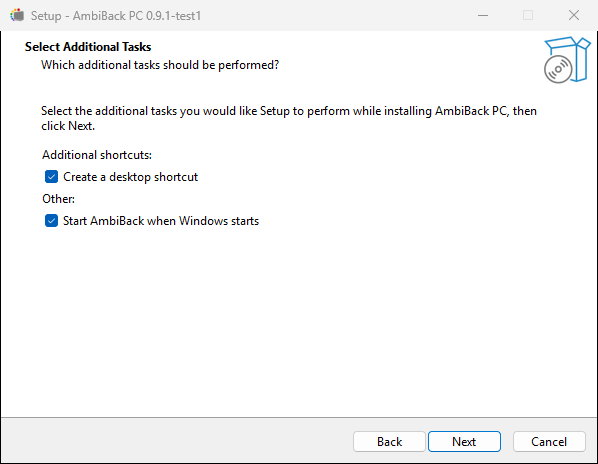

# Installation

**English** · [Deutsch](../de/installation.md) · [User guide](../user-guide.md)

## What you need

- Windows 10 or 11.
- The .NET Framework 4.7.2 or later. Current Windows versions already have it; otherwise the setup installs it.
- The Microsoft Edge WebView2 Runtime, for the device web pages and the calibration videos. The setup installs it when it is missing.
- The PC and the lights on the same local network.
- For an AmbiBack controller on USB, the driver of its USB chip if Windows does not have one: [FTDI VCP](https://ftdichip.com/drivers/vcp-drivers/) or [Silicon Labs CP210x](https://www.silabs.com/developers/usb-to-uart-bridge-vcp-drivers).

## Download

Download the latest version from the [releases page](https://github.com/ambiback/ambiback-pc/releases/latest). Each release has two files:

| File | Use it when |
| --- | --- |
| `AmbiBack-PC-<version>-setup.exe` | You want a normal installation with a Start menu entry, autostart and uninstaller. Recommended. |
| `AmbiBack-PC-<version>.zip` | You want a portable copy, for example on a USB stick, or you cannot run a setup. |

## Install with the setup

1. Run `AmbiBack-PC-<version>-setup.exe`.
2. **SmartScreen warning:** the files are not code-signed, so Windows may show "Windows protected your PC". Click **More info**, then **Run anyway**.
3. **Install mode** (asked on the first installation only): choose *Install for me only* (no administrator rights, installs to `%LOCALAPPDATA%\Programs\AmbiBack`) or *Install for all users* (needs administrator rights, installs to `C:\Program Files\AmbiBack`).
4. Accept the license (GPL 3).
5. **Additional tasks:**
   - *Start AmbiBack when Windows starts* (ticked by default).
   - *Create a desktop shortcut* (not ticked on the first installation).

   

   An update keeps the install mode and the choices of the previous installation.
6. If the .NET Framework is missing, the setup offers to download it from Microsoft (needs internet and administrator rights). Windows may ask for a restart afterwards.
7. Finish with *Launch AmbiBack PC* ticked.

The setup speaks German or English, following the Windows language.

## Use the portable ZIP

1. Unzip the file to a folder you can write to, for example `D:\Tools\AmbiBack`.
2. Run `AmbiBack.exe`. If SmartScreen warns, click **More info**, then **Run anyway**.

The ZIP does not install the .NET Framework or WebView2. On current Windows both are usually present.

## First start

1. AmbiBack searches the network and the USB ports for devices.
2. **Windows Firewall** may ask whether AmbiBack may communicate on networks. Allow it on **private networks**. AmbiBack receives the answers of AmbiBack controllers on UDP port 1337; if you block it, the search finds no controllers. See [Troubleshooting › Firewall](troubleshooting.md#windows-firewall).
3. The main window opens. Continue with the [Quick start](quick-start.md).

Only one AmbiBack runs at a time. Starting it again brings the open window to the front.

## Where settings are stored

Settings and the device list are stored in the program folder when it is writable (portable use and *Install for me only*), otherwise in `%LOCALAPPDATA%\AmbiBack\PC`.

## Update

Run the setup of the new version. It closes a running AmbiBack, replaces the files and starts it again. Your settings and devices stay.

For the ZIP, unzip the new version over the old folder.

## Uninstall

Open Windows *Settings › Apps › Installed apps*, find **AmbiBack PC** and choose *Uninstall*. Before that, stop AmbiBack so that Hue lights are switched off cleanly.
