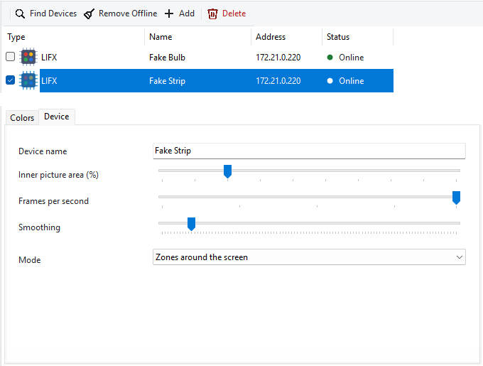

# LIFX lights

**English** · [Deutsch](../de/lifx.md) · [User guide](../user-guide.md)

AmbiBack PC drives LIFX lights directly on your network through the **LIFX LAN protocol**, without the LIFX cloud and without an account: bulbs, downlights, light strips (LIFX Z, Lightstrip), Beam and Neon.

## Add LIFX lights

Set up the light in the LIFX app first, so that it is on your Wi-Fi.

**Found on their own:** **Find Devices** (`F5`) asks the network for LIFX lights. Every light that answers appears in the list as *LIFX*, with the name from the LIFX app.

**By hand:** click **Add**, choose **LIFX** as device type (or leave *Detect the device type automatically* ticked) and enter the IP address of the light.

AmbiBack PC finds a light again by its MAC address, also under a new address.

## Bulbs and strips

| Light | What AmbiBack PC sends |
| --- | --- |
| **Bulbs and other one-color lights** | The average color of the screen. There is no mode setting. |
| **Multizone lights** (LIFX Z, Lightstrip, Beam, Neon) | Mode **Zones around the screen** (default): every zone gets its own color, the strip runs around the screen like an [AmbiBack controller](ambiback-devices.md#set-up-the-led-layout) (zones per side, start corner and direction on the monitor card). Mode **One color on all zones**: the average color. |

The mode is set on the **Device** tab:



For a strip AmbiBack PC suggests a layout from its zone count. Lights with a grid of zones (Tile, Candle, Ceiling) and strips with old firmware get one color.

## Start and stop

1. Click **Use** on the monitor card and tick the LIFX lights in the device list.
2. Click **Start**.

AmbiBack PC switches the light on. When it stops, the light goes back to the color and on/off state it had before.

## Settings

All sliders on the [*Colors* and *Device* tabs](settings.md) work for LIFX:

- **Frames per second**: 20, which is also the most LIFX allows per light.
- **Smoothing**: 100 ms by default. The light also fades to every new color within one frame.
- **Red, Green, Blue**, **Color boost**, **Value gain**, **Maximum brightness** and **Minimum brightness** are applied in AmbiBack PC.

## Check without a monitor

From a command line you can list the LIFX lights and stream a moving test picture to the first strip (or the first light):

```powershell
& "$env:LOCALAPPDATA\Programs\AmbiBack\AmbiBack.exe" --lifx-test 10
```

Put an IP address before the seconds to use only that light; add `single` at the end for one color.

## Problems

| Problem | Solution |
| --- | --- |
| No LIFX light is found | Is it set up in the LIFX app and on the same network? Some routers block broadcasts between Wi-Fi and LAN; **Add** it by IP address. LIFX answers on a random port, so Windows Firewall must allow the AmbiBack program itself (see [Firewall](troubleshooting.md#windows-firewall)), not only single ports. |
| A strip shows only one color | Its firmware may be too old for zones: update it in the LIFX app, then click **Find Devices**. |
| Colors on the wrong side | Change the start corner or direction on the monitor card. Check the zones per side. |
| The light reacts with a delay | Weak Wi-Fi delays the messages. Lower *Frames per second* a little. |
