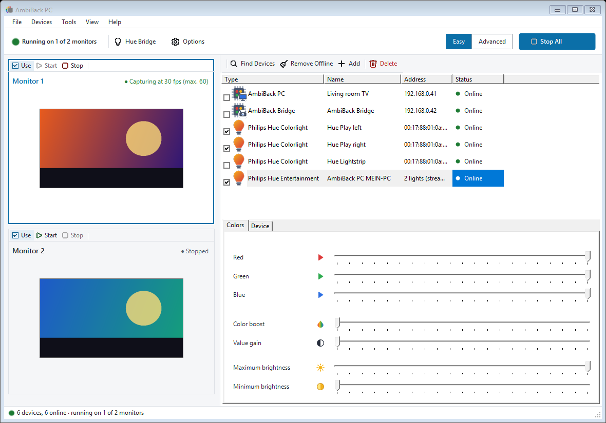

# The main window

**English** · [Deutsch](../de/main-window.md) · [User guide](../user-guide.md)

The window has four parts.

## Toolbar

| Item | Meaning |
| --- | --- |
| Status dot and text | Green: AmbiBack is running, with the number of active monitors. Grey: not running. |
| **Hue Bridge** | Connects the Philips Hue Bridge (see [Philips Hue](philips-hue.md)). |
| **Options** | Start with Windows, language, log file (see [Options](settings.md#options)). |
| **Easy / Advanced** | Easy shows what you need. Advanced adds the *Debug* tab and the list views. |
| **Start All / Stop All** | Starts or stops the ambient light on all monitors in use. |

Every toolbar command is in the menu as well: *File* (Start/Stop All, Options, Exit), *Devices* (Find, Add, Details, Wi-Fi, Remove Offline, Delete), *Tools* (Hue Bridge, calibration and demo videos), *View* and *Help*.

## Monitor cards (left)

One card per connected monitor with a live preview and its state (e.g. "Capturing at 30 fps"). See [Monitors and screen areas](#monitors-and-screen-areas) below.

## Device list (top right)

All lights found, with type, name, address and status (green dot = online, blue dot = connected over USB). The **checkbox** in front of a device links it to the monitor selected on the left. For Hue lights the checkbox means something else, see [The PC group in the device list](philips-hue.md#the-pc-group-in-the-device-list).

## Settings (bottom right)

Sliders for the device selected in the list (see [Settings](settings.md)).

The **status bar** shows how many devices are online and on how many monitors AmbiBack runs.

## Monitors and screen areas

Every monitor card has three buttons:

| Button | Meaning |
| --- | --- |
| **Use** | Turns screen capture on for this monitor. Devices can only start after that. |
| **Start** | Starts the ambient light for all devices linked to this monitor. |
| **Stop** | Stops them. Hue lights are switched off. |

**Linking devices:** click a monitor card (it gets a blue border) and tick the devices that belong to it in the device list. A device is linked to one monitor; a monitor can feed several devices.

**Choosing screen areas:** select a device in the list. The selected monitor card then shows which parts of the picture it reads:

- **AmbiBack controller:** the number of LEDs *vertical* and *horizontal*, and with the boxes in the corners where the LED strip starts and in which direction it runs (the arrows show the path).
- **Hue light:** twelve sectors along the screen edge (three each on the right, top, left and bottom). Ticked sectors are averaged, so a light to the left of the monitor gets the left sectors. The easiest way is the [Choose Lights](philips-hue.md#step-2-choose-lights) assistant.
- **Hue entertainment area:** no sectors; the areas follow the positions of the lights in the area (see [Entertainment areas from the Hue app](philips-hue.md#entertainment-areas-from-the-hue-app)).

When a monitor turns off (power saving), AmbiBack pauses and switches Hue lights off.

## Calibration and demo videos

*Tools › Calibration and Demo Videos* opens a YouTube playlist of ambient light test videos. Play one full screen on the monitor to check that the lights show the right colors in the right places.

## Notification area (tray)

The AmbiBack icon in the notification area shows in its tooltip whether and on how many monitors AmbiBack runs. Its menu offers:

- The status
- **Start All Monitors** / **Stop All Monitors**
- **Show AmbiBack**
- **Exit** (switches Hue lights off first)

If the icon is hidden, click the arrow `^` in the taskbar. To keep it visible, drag it onto the taskbar.
