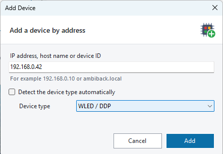
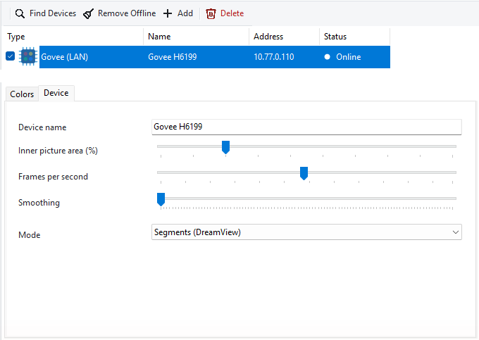
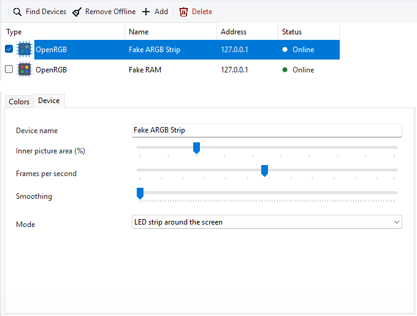
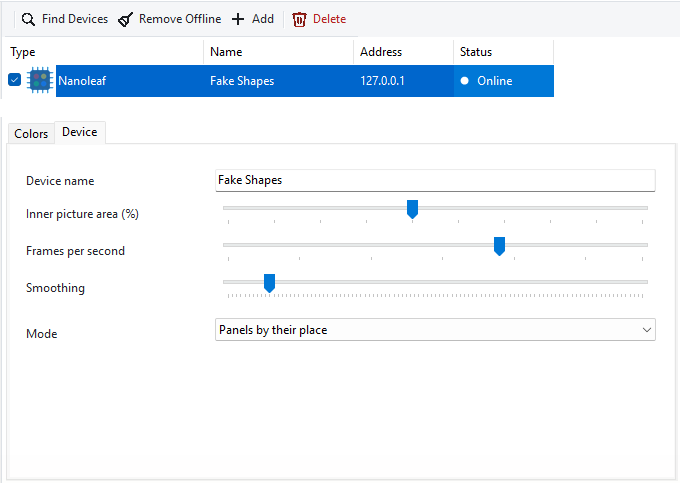
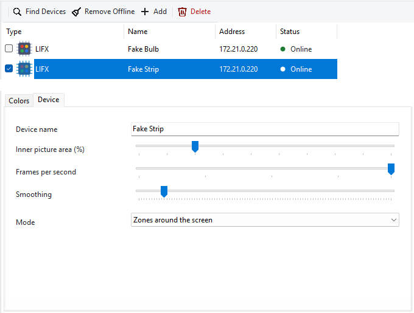
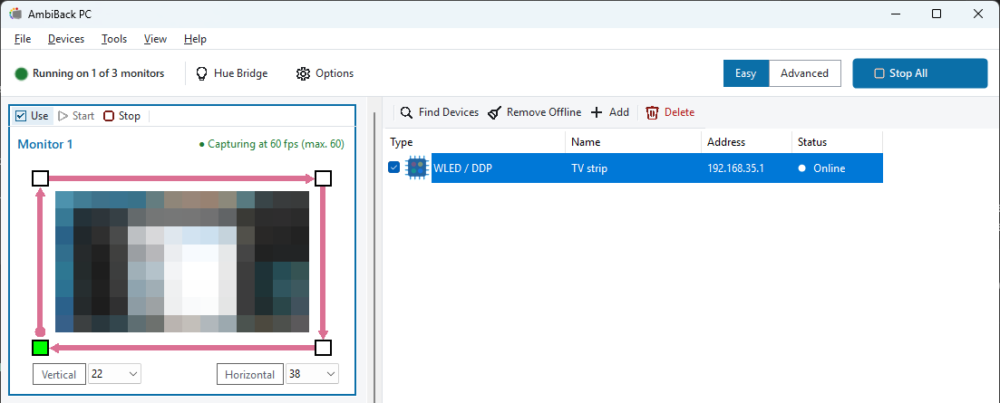

# Network lights step by step

**English** · [Deutsch](../de/network-lights.md) · [User guide](../user-guide.md)

Besides AmbiBack controllers and Philips Hue, AmbiBack PC drives five more kinds of lights directly on your network: **WLED** (and other DDP strips), **Govee**, **OpenRGB**, **Nanoleaf** and **LIFX**. They all work the same way. This tutorial walks through it once, from preparing the light to stopping it, and shows where the light types differ.

> ### Help wanted: testers
>
> I can only test with my own devices: **WLED** and **Philips Hue**, perhaps **Govee** soon. **OpenRGB**, **Nanoleaf** and **LIFX** were built from the published protocol descriptions and tested against simulated devices, not against real ones.
>
> If you own one of these lights, a short test helps a lot: follow this tutorial, then tell me what worked and what did not. See [Report a test](#report-a-test) at the end. Thank you!

| Light | Tested with real devices | What to look at |
| --- | --- | --- |
| WLED / DDP | maintainer's own devices | other DDP receivers (ESPHome, Hyperion, ESPixelStick) |
| Philips Hue | maintainer's own devices | – |
| Govee | perhaps soon by the maintainer | *Segments* mode on DreamView models, *Single color* on others |
| OpenRGB | **testers wanted** | motherboards, RAM, fans, LED strips, keyboards |
| Nanoleaf | **testers wanted** | panel places and the rotation from the Nanoleaf app |
| LIFX | **testers wanted** | bulbs, LIFX Z / Lightstrip / Beam / Neon zones |

## Step 1: Prepare the light

Each light type needs one thing before AmbiBack PC can use it:

| Light | Before you start |
| --- | --- |
| [WLED](wled.md) | Nothing. The strip must be on your Wi-Fi. |
| [Govee](govee.md) | In the Govee Home app switch on **LAN Control** for the light. |
| [OpenRGB](openrgb.md) | Start OpenRGB and click **Start Server** on its *SDK Server* tab. |
| [Nanoleaf](nanoleaf.md) | Nothing yet; you pair it with its power button in step 2. |
| [LIFX](lifx.md) | Set the light up in the LIFX app, so that it is on your Wi-Fi. |

The PC and the lights must be on the same network. If Windows Firewall asks on the first start, allow AmbiBack on **private networks**.

## Step 2: Find or add the light

**Automatically:** AmbiBack PC searches when it starts; click **Find Devices** (`F5`) to search again. WLED, Govee, OpenRGB (on this PC) and LIFX lights appear in the device list on their own, with their names. A green dot means online.

**By hand:** if a light is not found, click **Add** and enter its IP address. You find the address in your router or in the app of the light.

- Leave *Detect the device type automatically* ticked: AmbiBack PC tries WLED, Govee, OpenRGB and LIFX at that address.
- Or untick it and choose the type yourself. For a DDP receiver that is not WLED choose **WLED / DDP**; for OpenRGB on another PC choose **OpenRGB** (all its devices are added).
- **Nanoleaf** is always added this way: choose **Nanoleaf**, enter its address (or leave it empty to take the first Nanoleaf found), click **OK**, hold the power button for 5–7 seconds until the lights flash, and click **OK** again within 30 seconds.

Every light is recognized again later by its MAC address, serial number or device ID, also when your router gives it a new address. Its settings stay.

## Step 3: Link the light to a monitor

1. Click **Use** on the card of the monitor the light belongs to. The card shows a live preview.
2. Click the card to select it (blue border).
3. Tick the light in the device list.
4. Select the light (click its name). The tabs below the list now show its settings.

## Step 4: Choose the mode

Open the **Device** tab. For Govee, OpenRGB, Nanoleaf and LIFX strips there is a **Mode** setting where AmbiBack controllers have their connection type:

| Govee | OpenRGB |
| --- | --- |
|  |  |

| Nanoleaf | LIFX |
| --- | --- |
|  |  |

| Light | Modes |
| --- | --- |
| WLED | none: always a strip around the screen |
| Govee | **Segments (DreamView)**: one color per segment, only on models with DreamView · **Single color**: works on every model |
| OpenRGB | **LED strip around the screen** (default for LED strips) · **One color on all LEDs** (default for everything else) |
| Nanoleaf | **Panels by their place** · **One color on all panels** |
| LIFX | strips: **Zones around the screen** · **One color on all zones**; bulbs: none, always one color |

Tip: start with the one-color mode if you are not sure. It works on every light and shows at once whether the connection is fine.

## Step 5: Set up the layout

In a strip mode the light runs around the screen. The monitor card shows the layout:

1. Set the number of LEDs (or segments, or zones) **vertical** (one side) and **horizontal** (top or bottom).
2. With the boxes in the corners, choose where the strip starts and in which direction it runs. The arrows show the path.
3. Check it with a [calibration video](main-window.md#calibration-and-demo-videos) (*Tools › Calibration and Demo Videos*) played full screen: the light must show the colors in the places where the video shows them.

For WLED, OpenRGB and LIFX strips AmbiBack PC suggests a layout from the LED count the light reports. For Govee set the counts so that the total matches the segments of your light.

**Nanoleaf** has no strip layout: every panel takes its place from the layout in the Nanoleaf app. In one-color modes the monitor card shows no layout either.

## Step 6: Start and fine-tune

Click **Start** on the monitor card, or **Start All** in the toolbar. The light now follows the picture.

Fine-tune on the [*Colors* and *Device* tabs](settings.md):

| Light | Frames per second | Smoothing |
| --- | --- | --- |
| WLED | 50 (up to 60) | off |
| Govee | 30 (single color: at most 10 colors per second) | off |
| OpenRGB | 30 (up to 60) | off |
| Nanoleaf | 20 (up to 30) | 100 ms |
| LIFX | 20 (the most LIFX allows) | 100 ms |

- **Colors too pale or too strong:** *Color boost*, *Value gain*, the *Red*, *Green* and *Blue* sliders.
- **Too bright:** *Maximum brightness*. Dark scenes too dark: *Minimum brightness*.
- **Flickers or jumps:** raise *Smoothing* or lower *Frames per second*.
- **Colors on the wrong side:** change the start corner or direction (step 5).

## Step 7: Stop

Click **Stop** (or **Stop All**). What the light does then:

| Light | After stopping |
| --- | --- |
| WLED | returns to its own effect after about 2.5 seconds |
| Govee | *Segments*: back to the scene from the Govee app · *Single color*: keeps the last color |
| OpenRGB | keeps the last colors; load your profile in OpenRGB to get your lighting back |
| Nanoleaf | the effect that ran before is selected again |
| LIFX | gets the color and on/off state from before |

The same happens when the monitor turns off or the PC goes to sleep.

## Report a test

Every report helps, also "works fine". Please fill in the **[device test form](https://github.com/ambiback/ambiback-pc/issues/new?template=device-test.yml)** on GitHub (you need a free GitHub account). It asks for:

1. **The light:** brand, model (e.g. *Nanoleaf Shapes*, *LIFX Z*, *Govee H6199*) and, if you know it, the firmware.
2. **The AmbiBack PC version** (*Help › About AmbiBack PC*).
3. **What worked:** found on its own? Added by hand? Which mode? Do the colors appear in the right place? Smooth or jerky? Back to normal after stopping?
4. **What did not work**, and what you saw instead. A photo or short video helps a lot.
5. **The output of the command-line test**, if you can run it (it works without a monitor and while AmbiBack PC is open):

| Light | Command (in PowerShell) |
| --- | --- |
| WLED / DDP | `& "$env:LOCALAPPDATA\Programs\AmbiBack\AmbiBack.exe" --wled-test <address> 10` |
| Govee | `& "$env:LOCALAPPDATA\Programs\AmbiBack\AmbiBack.exe" --govee-test <address> 10` (add `single` for one color) |
| OpenRGB | `& "$env:LOCALAPPDATA\Programs\AmbiBack\AmbiBack.exe" --openrgb-test localhost 0 10` (the 0 is the device number from the list it prints) |
| Nanoleaf | `& "$env:LOCALAPPDATA\Programs\AmbiBack\AmbiBack.exe" --nanoleaf-test <address> 10` (pairs first: hold the power button) |
| LIFX | `& "$env:LOCALAPPDATA\Programs\AmbiBack\AmbiBack.exe" --lifx-test 10` |

The test streams a slowly turning color wheel for the given seconds. On a strip around the screen the colors should run around once every 5 seconds. Stop the monitor that drives the same light first, so that only one program sends. The Nanoleaf test prints an auth token; leave it out of your report.

Details for each light: [WLED](wled.md) · [Govee](govee.md) · [OpenRGB](openrgb.md) · [Nanoleaf](nanoleaf.md) · [LIFX](lifx.md) · [Troubleshooting](troubleshooting.md)
