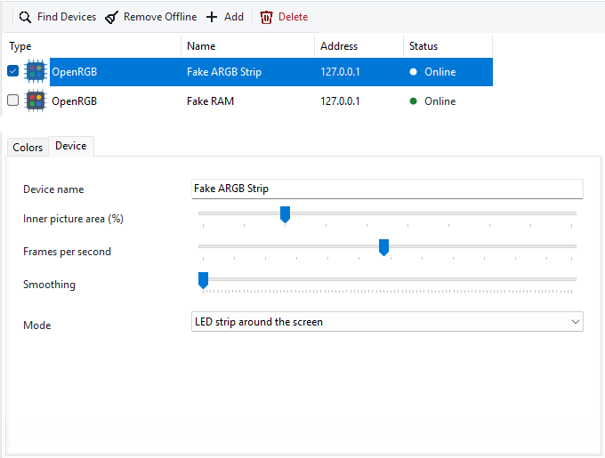

# OpenRGB devices

**English** · [Deutsch](../de/openrgb.md) · [User guide](../user-guide.md)

[OpenRGB](https://openrgb.org/) controls the RGB lighting of many PC parts and peripherals from one program: motherboards and their ARGB headers, RAM, graphics cards, fans and coolers, LED strips, keyboards, mice and more. AmbiBack PC talks to OpenRGB through its **SDK server** and can drive every device OpenRGB knows.

## Before you start: start the SDK server

1. Install and start OpenRGB, and check that it shows your devices.
2. Open the **SDK Server** tab and click **Start Server** (port 6742).
   To have it always on, start OpenRGB with `--server`, or tick the option to start the server automatically in OpenRGB's settings.

OpenRGB must keep running while AmbiBack PC uses its devices.

## Add OpenRGB devices

**Found on their own:** **Find Devices** (`F5`) asks the OpenRGB SDK server on this PC. Every OpenRGB device appears in the list as *OpenRGB*, with the name OpenRGB gives it.

**By hand:** click **Add**, choose **OpenRGB** as device type and enter the address of the PC that runs OpenRGB (`localhost` for this PC). All devices of that OpenRGB are added. Use this for an OpenRGB on another PC.

AmbiBack PC finds a device again by its name and location, even if OpenRGB lists the devices in another order.

## Choose the mode

Select the device and open the **Device** tab. The *Mode* setting replaces the connection setting there:



| Mode | What it does |
| --- | --- |
| **LED strip around the screen** | The LEDs of the device, in OpenRGB's order, run around the screen. Set up the layout like for an [AmbiBack controller](ambiback-devices.md#set-up-the-led-layout): LEDs per side, start corner and direction on the monitor card. LED strips start in this mode. |
| **One color on all LEDs** | Every LED gets the average color of the screen. For fans, RAM, keyboards, case lights and everything not mounted around the screen. All other devices start in this mode. |

For a device found by OpenRGB, AmbiBack PC suggests a layout from its LED count, split for a 16:9 screen. LEDs beyond the layout stay dark. If the device has several zones (shown in the list details), the strip follows the order of the zones in OpenRGB.

## Start and stop

1. Click **Use** on the monitor card and tick the OpenRGB devices in the device list.
2. Click **Start**.

AmbiBack PC switches the device to OpenRGB's direct mode and sends all LED colors with every frame. After stopping, the device keeps the last colors; to get your usual lighting back, load your profile in OpenRGB.

Only one program should set the colors at a time: stop effects and other tools in OpenRGB for these devices.

## Settings

All sliders on the [*Colors* and *Device* tabs](settings.md) work for OpenRGB:

- **Frames per second**: 30 by default, up to 60. Some devices (e.g. on the motherboard bus) are slower; lower the value if colors lag behind.
- **Smoothing**: 0 (off) by default. AmbiBack PC fades the colors before sending.
- **Red, Green, Blue**, **Color boost**, **Value gain**, **Maximum brightness** and **Minimum brightness** are applied in AmbiBack PC.

## Check without a monitor

From a command line you can list the devices of an OpenRGB and stream a moving test picture to one of them:

```powershell
& "$env:LOCALAPPDATA\Programs\AmbiBack\AmbiBack.exe" --openrgb-test localhost 0 10
```

The arguments are the address, the device number from the list it prints, and the seconds; add `single` for *One color on all LEDs*.

## Problems

| Problem | Solution |
| --- | --- |
| No OpenRGB device is found | Is OpenRGB running and the SDK server started (*SDK Server* tab, *Start Server*)? Does OpenRGB itself show the devices? |
| An OpenRGB on another PC is not found | **Add** it by address. On that PC Windows Firewall must let OpenRGB accept connections on TCP port 6742. |
| A device stays offline after OpenRGB was restarted | Click **Find Devices**. If OpenRGB renamed the device, add it again and delete the old entry. |
| Colors flicker or fight with an effect | Stop effects for this device in OpenRGB and close other RGB tools (vendor software) that control it. |
| Colors on the wrong place | In *LED strip* mode: change start corner or direction, or the LEDs per side. For devices not around the screen use *One color on all LEDs*. |
