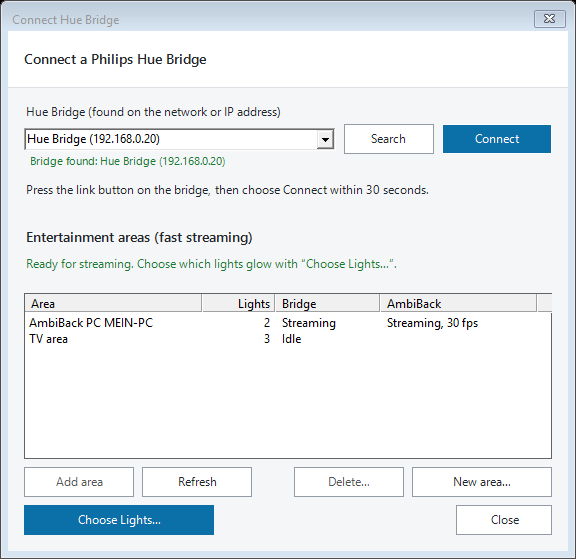
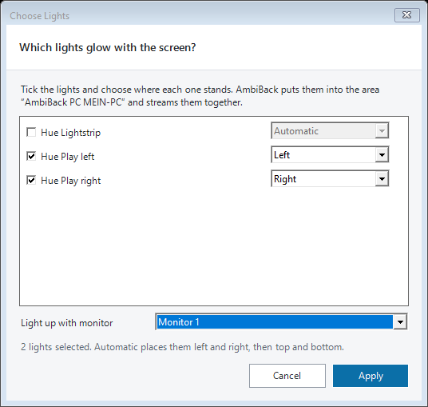
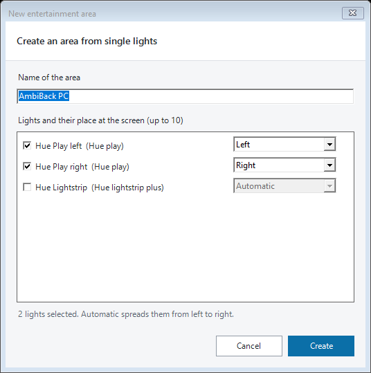

# Philips Hue

**English** · [Deutsch](../de/philips-hue.md) · [User guide](../user-guide.md)

## How it works

AmbiBack controls Hue lights only through the **Hue Entertainment API**: the colors of all lights go encrypted (DTLS) 25 to 50 times per second in one stream to the bridge, which passes them on to the lights in sync. This is the same path the Hue app uses for "Sync". AmbiBack does not use single color commands over HTTP, which are slow and overload the bridge.

The stream always goes to an **entertainment area** of the bridge. AmbiBack creates its own, **"AmbiBack PC <computer name>"**, and keeps it up to date with the lights you choose. You can also use an area set up in the Hue app.

**You need** a second-generation (square) Hue Bridge with current firmware and color lights that support entertainment. Plugs and white-only lights are not shown.

## Step 1: Connect the bridge

Click **Hue Bridge** in the toolbar.

1. **Choose the bridge:** on the first open AmbiBack looks for the bridge and fills it in ("Bridge found: …"). With several bridges the list opens so you can pick one. **Search** looks again. You can also type an IP address.
2. **Press the link button:** press the round button on top of the bridge.
3. **Connect:** click **Connect** within 30 seconds. AmbiBack registers with the bridge and receives the key for streaming.
4. The **Choose Lights** assistant opens next.

The status line under "Entertainment areas" shows where you are: *Not connected*, *without a streaming key* (press the link button and connect again) or *Ready for streaming*.

The list shows all entertainment areas of the bridge with the number of lights, their state on the bridge (*Streaming* / *Idle*) and in AmbiBack (e.g. *Streaming, 30 fps*).

You connect only once. AmbiBack remembers the bridge and its key.

## Step 2: Choose lights

The assistant appears after connecting and any time from **Choose Lights…** in the Hue dialog.

1. **Tick the lights** that should glow with the screen (at most 10, a limit of the bridge).
2. **Choose where each light stands:** *Left*, *Right*, *Top*, *Bottom* or a corner. *Automatic* places the lights left and right, then top and bottom. This sets the parts of the picture each light reads.
3. **Choose the monitor** the lights glow with.
4. **Apply:** AmbiBack creates or updates the area "AmbiBack PC <computer name>" and links it to the monitor. If the monitor is running, the lights start right away.

## Step 3: Start

Make sure the monitor card shows **Use** turned on, then click **Start** on the card (or **Start All**). The lights switch on and follow the picture.

## The PC group in the device list

After the assistant the device list shows:

- **Philips Hue Entertainment "AmbiBack PC <computer name>"**: the group. **Only this device is linked to a monitor and started.** It streams all its lights together.
- **Philips Hue Colorlight**: the single lights. Their **checkbox means "belongs to the group"**, whichever monitor is selected. Ticking or unticking a light updates the group on the bridge, also while it runs; lights taken out are switched off. When you select a light you can set its sectors on the monitor card and its own color sliders.

Single lights never send by themselves. If no light is ticked, the group shows *No lights in the group*.

On **Stop**, **monitor off** and **Exit**, AmbiBack switches the lights off. On start it switches them on again.

## Entertainment areas from the Hue app

You can also use an area set up in the Hue app (*Settings › Entertainment areas*): select it in the list and click **Add area** (or double-click it). It appears as a device of its own that you link to a monitor. Every light reads the part of the picture at its position in the area (left/right and height). If the lights have no position, AmbiBack spreads them from left to right. Set the size of the regions with *Inner picture area (%)*.

The bridge streams only **one** area at a time. For the same lights, use either the PC group or an area from the Hue app.

## Creating and deleting areas

**New area…** creates an extra area from lights and places you choose, for example for a second monitor:

**Delete…** removes the selected areas from the bridge after asking. The lights themselves stay. This is needed when the bridge is full: it holds **at most 20 entertainment areas**.

## Network

AmbiBack talks to the bridge over HTTPS (TCP 443) and streams over DTLS (UDP 2100). Both are outgoing connections that Windows Firewall allows by default. Hue problems: see [Troubleshooting › Philips Hue](troubleshooting.md#philips-hue).
