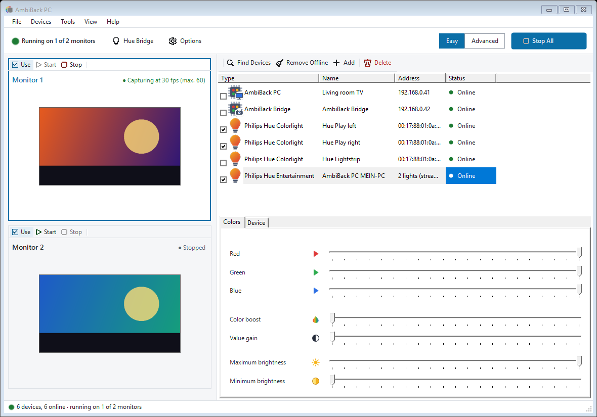

# Quick start

**English** · [Deutsch](../de/quick-start.md) · [User guide](../user-guide.md)

From download to light on the wall in a few minutes.

## 1. Install

Download `AmbiBack-PC-<version>-setup.exe` from the [releases page](https://github.com/ambiback/ambiback-pc/releases/latest) and run it. If SmartScreen warns, click **More info › Run anyway**. Details: [Installation](installation.md).

## 2. Start and allow the firewall

On the first start, allow AmbiBack on **private networks** when Windows Firewall asks. AmbiBack then searches for devices on its own.

## 3. Add your lights

Do the part that fits your lights:

- **AmbiBack controller (LED strip):** it appears in the device list after the search (green dot = online). If not, click **Add** and enter its IP address. A new controller without Wi-Fi: connect it over USB and use **Connect to Wi-Fi…**. Details: [AmbiBack devices](ambiback-devices.md).
- **Philips Hue:** click **Hue Bridge**, press the link button on the bridge, click **Connect** within 30 seconds, then tick your lights and their places in **Choose Lights** and click **Apply**. Details: [Philips Hue](philips-hue.md).

## 4. Link lights and monitor

1. Click **Use** on the card of the monitor the lights belong to. The card gets a live preview.
2. Click the card to select it (blue border).
3. In the device list, tick the devices that belong to this monitor. For Hue, tick the group **Philips Hue Entertainment "AmbiBack PC <computer name>"**; the Choose Lights assistant has already done this.

## 5. Start

Click **Start** on the monitor card, or **Start All** in the toolbar. The lights now follow the picture.

## 6. Fine-tune

- For an LED strip, select the controller and set the number of LEDs and where the strip starts on the monitor card ([Monitors and screen areas](main-window.md#monitors-and-screen-areas)).
- Adjust brightness and color with the sliders ([Settings](settings.md)).
- In [Options](settings.md#options), set whether AmbiBack starts with Windows and hides in the notification area.

Something not working? See [Troubleshooting](troubleshooting.md).
