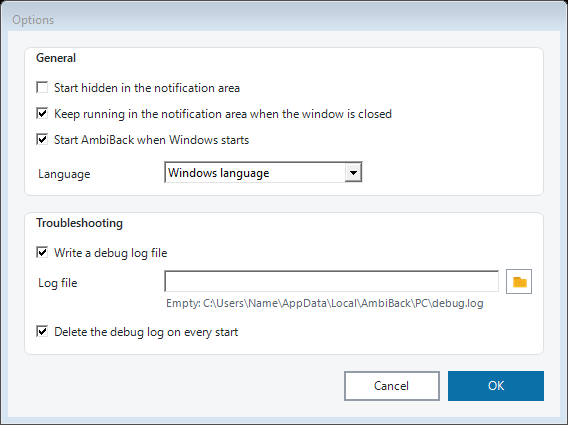

# Settings and options

**English** · [Deutsch](../de/settings.md) · [User guide](../user-guide.md)

## Device settings

The sliders at the bottom right apply to the device selected in the list and take effect right away.

### Colors tab

| Slider | Effect |
| --- | --- |
| Red, Green, Blue | Share of each color in percent, e.g. to balance a tint of the LEDs or the wall. |
| Color boost | Strengthens the dominant color and dims the others; the light gets more saturated. |
| Value gain | Brightens dark pictures (above 100 %). |
| Maximum brightness | Upper limit of the brightness. |
| Minimum brightness | Lower limit, so dark scenes do not go completely dark. |

### Device tab

| Setting | Effect |
| --- | --- |
| Device name | Name of the device, where the device supports renaming. |
| Connection | *UDP* works on any Wi-Fi and is the default; *TCP* needs a stable Wi-Fi; *USB* for controllers connected directly. For a Govee light this row is *Mode*: [segments or single color](govee.md#choose-the-mode); for an OpenRGB device [strip or one color](openrgb.md#choose-the-mode); for a Nanoleaf [panels by their place or one color](nanoleaf.md#choose-the-mode). |
| Frames per second | How often colors are sent. Hue streaming: 25 to 50. WLED/DDP: up to 60. Govee and OpenRGB: 30 by default. Nanoleaf: 20, up to 30. |
| Smoothing | Transition time between colors (not for Hue; the bridge smooths by itself). For WLED/DDP, Govee, OpenRGB and Nanoleaf AmbiBack PC smooths before sending (Nanoleaf: 100 ms by default). |
| Inner picture area (%) | How far the areas reach into the picture. For Hue areas and Nanoleaf: the size of the region around each light or panel. |

### Debug tab

In *Advanced* mode, controllers with debug support also get the **Debug** tab (syslog output, device info, restart).

## Options

Click **Options** in the toolbar.

| Option | Meaning |
| --- | --- |
| Start hidden in the notification area | The window stays hidden on start; AmbiBack runs in the notification area. |
| Keep running in the notification area when the window is closed | The close button only hides the window. Exit with *File › Exit* or the tray menu. |
| Start AmbiBack when Windows starts | Adds this copy of AmbiBack to Windows startup. The line below shows which program Windows starts at the moment. If it is another copy, tick the box to start this copy instead. |
| Language | German, English or the Windows language. |
| Debug log | Writes a log for troubleshooting; empty = default path. Hue keys are never logged. |

**Tip:** for an ambient light that is simply always there, tick all three: start with Windows, start hidden, keep running when closed. Then click **Start All** once; AmbiBack remembers which monitors run.
