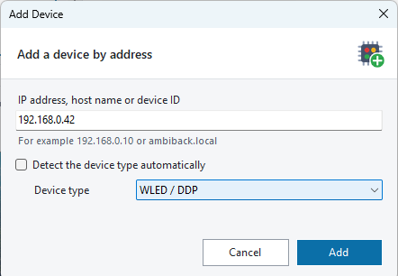
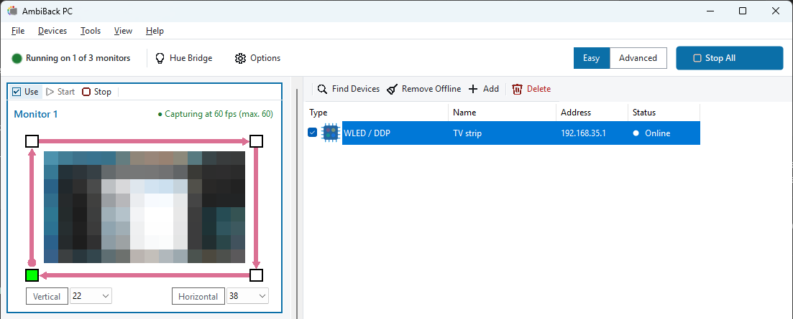

# WLED and other DDP receivers

**English** · [Deutsch](../de/wled.md) · [User guide](../user-guide.md)

AmbiBack PC can drive an LED strip with [WLED](https://kno.wled.ge/) firmware, and any other receiver of the **DDP** protocol (Distributed Display Protocol, UDP port 4048), for example ESPHome, Hyperion or ESPixelStick. WLED runs on cheap ESP8266/ESP32 boards, and many strips sold for smart home apps can be flashed with it.

AmbiBack PC computes the color of every LED itself and sends the finished values. Layout, color sliders and smoothing are set in AmbiBack PC, not in WLED.

## Add a WLED device

**Found on their own:** **Find Devices** (`F5`) also asks the network for WLED devices (mDNS, `_wled._tcp`). Every WLED that answers appears in the list as *WLED / DDP*, with the name and LED count it reports.

**By hand:** click **Add** and enter the IP address or host name (e.g. `wled-tv.local`).



- With *Detect the device type automatically* ticked, AmbiBack asks the address for WLED (`/json/info`) and adds it as WLED if it answers.
- For a DDP receiver that is not WLED, untick it and choose **WLED / DDP** as device type.

Tip: give the device a fixed IP address in your router. A WLED found again under a new address keeps its settings (it is recognized by its MAC address).

## Set up the LED layout

The layout works like for an [AmbiBack controller](ambiback-devices.md#set-up-the-led-layout):

1. Click **Use** on the monitor card and tick the WLED device in the device list.
2. Select the device. On the monitor card set the number of LEDs **vertical** (one side) and **horizontal** (top or bottom), and the start corner and direction.
3. Click **Start**.



For a WLED found on the network AmbiBack suggests a layout from its LED count, split for a 16:9 screen. Check it against your strip: the count per side must match the LEDs that really sit on that side. The layout covers at most 120 LEDs horizontal and 60 vertical.

## Settings

All sliders on the [*Colors* and *Device* tabs](settings.md) work for WLED (the *Connection* setting does not apply, DDP always uses UDP):

- **Frames per second**: 50 by default, up to 60.
- **Smoothing**: 0 (off) by default. Higher values fade the colors more softly; AmbiBack PC does this before sending.
- **Red, Green, Blue**, **Color boost**, **Value gain**, **Maximum brightness** and **Minimum brightness** are applied in AmbiBack PC. Keep the brightness in WLED at 100 % and limit it here instead, or set a current limit in WLED for the power supply.

## What happens on the WLED side

WLED switches to live mode as soon as the first frame arrives (the WLED web page shows *live*). When AmbiBack stops, the monitor turns off or the PC goes to sleep, WLED returns to its own effect after about 2.5 seconds.

## Check without a monitor

From a command line you can stream a moving test picture to a device:

```powershell
& "$env:LOCALAPPDATA\Programs\AmbiBack\AmbiBack.exe" --wled-test 192.168.0.42 10
```

It reports what WLED says about itself, the layout it uses, and the frames per second it sends. It also runs while AmbiBack PC is open; stop the monitor that drives this device first, so that only one sends.

## Problems

| Problem | Solution |
| --- | --- |
| A WLED is not found | Is it on the same network? Some routers block mDNS between Wi-Fi and LAN. **Add** it by IP address. |
| The strip stays dark or shows its effect | Is the device ticked for the monitor and the monitor started? In WLED check *Config › Sync Interfaces › Realtime*: *Receive UDP realtime* must be on. |
| Colors on the wrong side | Change the start corner or direction on the monitor card. Check the LED counts per side. |
| Only part of the strip lights up | The layout has fewer LEDs than the strip. Increase the counts per side, or shorten the LED count in WLED. |
| The strip flickers | Lower *Frames per second* or raise *Smoothing*. Weak Wi-Fi drops frames; place the controller closer to the router. |
