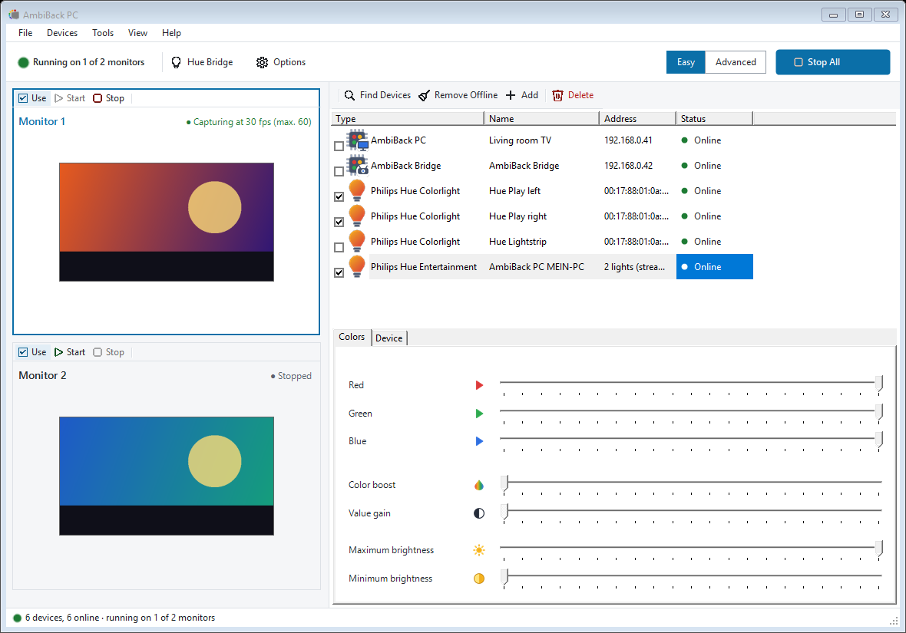
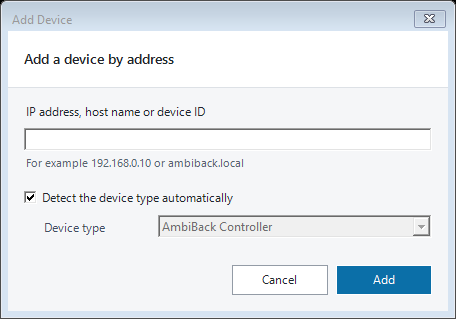
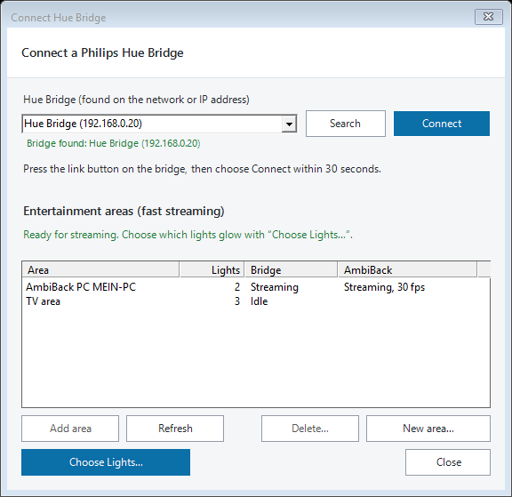
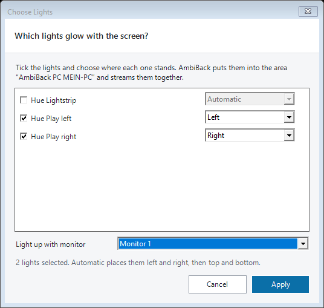
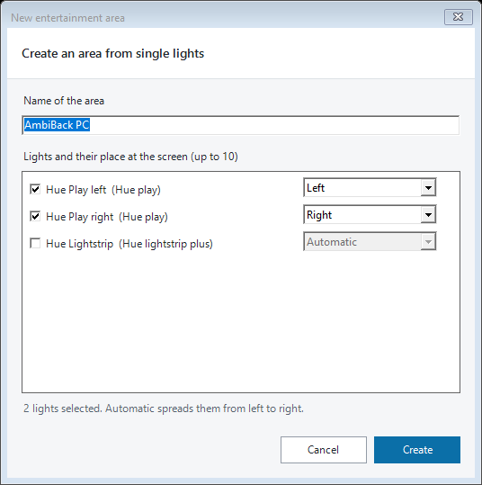
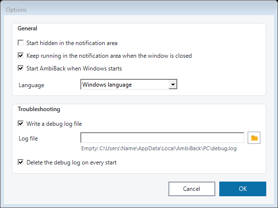

# AmbiBack PC – User Guide

**English** · [Deutsch](benutzerhandbuch.md)

AmbiBack PC captures what your monitors show and sends the colors in real time to lights behind or next to the screen: AmbiBack controllers (LED strips), Philips Hue lights and, in builds with DreamScreen support, DreamScreen devices. The picture seems to flow onto the wall.

This guide explains every window of the app, how to set up AmbiBack devices and Philips Hue, and what to do when something does not work.

## Contents

1. [Requirements and first start](#1-requirements-and-first-start)
2. [The main window](#2-the-main-window)
3. [Setting up AmbiBack devices](#3-setting-up-ambiback-devices)
4. [Monitors and screen areas](#4-monitors-and-screen-areas)
5. [Colors and device settings](#5-colors-and-device-settings)
6. [Philips Hue](#6-philips-hue)
7. [Options](#7-options)
8. [Notification area (tray)](#8-notification-area-tray)
9. [Troubleshooting](#9-troubleshooting)
10. [Privacy and security](#10-privacy-and-security)

---

## 1. Requirements and first start

- Windows 10 or 11 with .NET Framework 4.7.2 or later (already present on current Windows versions).
- For the device web pages and the calibration videos: the Microsoft Edge WebView2 Runtime (usually installed).
- The PC and the lights in the same local network; for USB devices the driver of the USB chip if needed (see the [README](../README.md)).

Run `AmbiBack.exe`. On the first start AmbiBack searches the network and the USB ports for devices. Only one instance runs; starting it again brings the existing window to the front.

Settings and the device list are stored in the program folder when it is writable (portable use), otherwise in `%LOCALAPPDATA%\AmbiBack\PC`.

## 2. The main window

The window has four parts:

**Toolbar (top)**

| Item | Meaning |
| --- | --- |
| Status dot and text | Green: AmbiBack is running, with the number of active monitors. Grey: not running. |
| **Hue Bridge** | Connects the Philips Hue Bridge (see [chapter 6](#6-philips-hue)). |
| **Options** | Start with Windows, language, log file (see [chapter 7](#7-options)). |
| **Easy / Advanced** | Easy shows what you need. Advanced adds the *Debug* tab and the list views. |
| **Start All / Stop All** | Starts or stops the ambient light on all monitors in use. |

Every toolbar command is in the menu as well: *File* (Start/Stop All, Options, Exit), *Devices* (Find, Add, Details, Wi-Fi, Remove Offline, Delete), *Tools* (Hue Bridge, calibration videos), *View* and *Help*.

**Monitor cards (left)** – one card per connected monitor with a live preview and its state (e.g. "Capturing at 30 fps"). See [chapter 4](#4-monitors-and-screen-areas).

**Device list (top right)** – all lights found, with type, name, address and status (green dot = online, blue dot = connected over USB). The **checkbox** in front of a device links it to the monitor selected on the left. For Hue lights the checkbox means something else, see [chapter 6.4](#64-the-pc-group-in-the-device-list).

**Settings (bottom right)** – sliders for the device selected in the list (see [chapter 5](#5-colors-and-device-settings)).

The **status bar** shows how many devices are online and on how many monitors AmbiBack runs.

## 3. Setting up AmbiBack devices

### Finding devices

**Find Devices** (or `F5`) sends a search into the local network and asks the USB ports. AmbiBack controllers that answer appear in the list. The search also runs on start.

### Adding a device by hand

If the search does not find a device (for example in another network segment), use **Add**:

1. Enter the IP address, host name (e.g. `ambiback.local`) or device ID.
2. Keep *Detect the device type automatically* ticked; AmbiBack then asks the device itself. Choose the type by hand only if that fails.
3. **Add**.

### More commands

- **Details** (double-click a device) opens the web page of the controller with all firmware settings.
- **Connect to Wi-Fi…** (context menu or *Devices* menu, only for USB connections) sends the Wi-Fi name and password to a new controller. It restarts and joins the network.
- **Remove Offline** removes every device that does not answer right now; for Hue lights and Hue areas it counts whether the bridge reported them.
- **Delete** removes the selected device from the list. If it is still on the network, *Find Devices* adds it again.

## 4. Monitors and screen areas

Every monitor card has three buttons:

| Button | Meaning |
| --- | --- |
| **Use** | Turns screen capture on for this monitor. Devices can only start after that. |
| **Start** | Starts the ambient light for all devices linked to this monitor. |
| **Stop** | Stops them. Hue lights are switched off. |

**Linking devices:** click a monitor card (it gets a blue border) and tick the devices that belong to it in the device list. A device is linked to one monitor; a monitor can feed several devices.

**Choosing screen areas:** select a device in the list. The selected monitor card then shows which parts of the picture it reads:

- **AmbiBack controller:** the number of LEDs *vertical* and *horizontal*, and with the boxes in the corners where the LED strip starts and in which direction it runs (the arrows show the path).
- **Hue light:** twelve sectors along the screen edge (three each on the right, top, left and bottom). Ticked sectors are averaged, so a light to the left of the monitor gets the left sectors. The easiest way is the [Choose Lights](#63-choose-lights) assistant.
- **Hue entertainment area:** no sectors; the areas follow the positions of the lights in the area (see [chapter 6.5](#65-entertainment-areas-from-the-hue-app)).

When a monitor turns off (power saving), AmbiBack pauses and switches Hue lights off.

## 5. Colors and device settings

The sliders apply to the device selected in the list and take effect right away.

**"Colors" tab**

| Slider | Effect |
| --- | --- |
| Red, Green, Blue | Share of each color in percent, e.g. to balance a tint of the LEDs or the wall. |
| Color boost | Strengthens the dominant color and dims the others; the light gets more saturated. |
| Value gain | Brightens dark pictures (above 100 %). |
| Maximum brightness | Upper limit of the brightness. |
| Minimum brightness | Lower limit, so dark scenes do not go completely dark. |

**"Device" tab**

| Setting | Effect |
| --- | --- |
| Device name | Name of the device, where the device supports renaming. |
| Connection | *UDP* works on any Wi-Fi and is the default; *TCP* needs a stable Wi-Fi; *USB* for controllers connected directly. |
| Frames per second | How often colors are sent. Hue streaming: 25 to 50. |
| Smoothing | Transition time between colors (not for Hue; the bridge smooths by itself). |
| Inner picture area (%) | How far the areas reach into the picture. For Hue areas: the size of the region around each light. |

In *Advanced* mode, controllers with debug support also get the **Debug** tab (syslog output, device info, restart).

## 6. Philips Hue

### 6.1 How it works

AmbiBack controls Hue lights only through the **Hue Entertainment API**: the colors of all lights go encrypted (DTLS) 25 to 50 times per second in one stream to the bridge, which passes them on to the lights in sync. This is the same path the Hue app uses for "Sync". AmbiBack does not use single color commands over HTTP, which are slow and overload the bridge.

The stream always goes to an **entertainment area** of the bridge. AmbiBack creates its own, **"AmbiBack PC <computer name>"**, and keeps it up to date with the lights you choose. You can also use an area set up in the Hue app.

You need a second-generation (square) Hue Bridge with current firmware and color lights that support entertainment. Plugs and white-only lights are not shown.

### 6.2 Connecting the bridge

Click **Hue Bridge** in the toolbar.

1. **Choose the bridge:** on the first open AmbiBack looks for the bridge and fills it in ("Bridge found: …"). With several bridges the list opens so you can pick one. **Search** looks again. You can also type an IP address.
2. **Press the link button:** press the round button on top of the bridge.
3. **Connect:** click **Connect** within 30 seconds. AmbiBack registers with the bridge and receives the key for streaming.
4. The **Choose Lights** assistant opens next.

The status line under "Entertainment areas" shows where you are: *Not connected*, *without a streaming key* (press the link button and connect again) or *Ready for streaming*.

The list shows all entertainment areas of the bridge with the number of lights, their state on the bridge (*Streaming* / *Idle*) and in AmbiBack (e.g. *Streaming, 30 fps*).

### 6.3 Choose Lights

The assistant appears after connecting and any time from **Choose Lights…** in the Hue dialog.

1. **Tick the lights** that should glow with the screen (at most 10, a limit of the bridge).
2. **Choose where each light stands:** *Left*, *Right*, *Top*, *Bottom* or a corner. *Automatic* places the lights left and right, then top and bottom. This sets the parts of the picture each light reads.
3. **Choose the monitor** the lights glow with.
4. **Apply:** AmbiBack creates or updates the area "AmbiBack PC <computer name>" and links it to the monitor. If the monitor is running, the lights start right away.

### 6.4 The PC group in the device list

After the assistant the device list shows:

- **Philips Hue Entertainment "AmbiBack PC <computer name>"** – the group. **Only this device is linked to a monitor and started.** It streams all its lights together.
- **Philips Hue Colorlight** – the single lights. Their **checkbox means "belongs to the group"**, whichever monitor is selected. Ticking or unticking a light updates the group on the bridge, also while it runs; lights taken out are switched off. When you select a light you can set its sectors on the monitor card and its own color sliders.

Single lights never send by themselves. If no light is ticked, the group shows *No lights in the group*.

On **Stop**, **monitor off** and **Exit**, AmbiBack switches the lights off. On start it switches them on again.

### 6.5 Entertainment areas from the Hue app

You can also use an area set up in the Hue app (*Settings › Entertainment areas*): select it in the list and click **Add area** (or double-click it). It appears as a device of its own that you link to a monitor. Every light reads the part of the picture at its position in the area (left/right and height). If the lights have no position, AmbiBack spreads them from left to right. Set the size of the regions with *Inner picture area (%)*.

The bridge streams only **one** area at a time. For the same lights, use either the PC group or an area from the Hue app.

### 6.6 Creating and deleting areas

**New area…** creates an extra area from lights and places you choose, for example for a second monitor:

**Delete…** removes the selected areas from the bridge after asking. The lights themselves stay. This is needed when the bridge is full: it holds **at most 20 entertainment areas**.

## 7. Options

| Option | Meaning |
| --- | --- |
| Start hidden in the notification area | The window stays hidden on start; AmbiBack runs in the notification area. |
| Keep running in the notification area when the window is closed | The close button only hides the window. Exit with *File › Exit* or the tray menu. |
| Start AmbiBack when Windows starts | Adds AmbiBack to Windows startup. |
| Language | German, English or the Windows language. |
| Debug log | Writes a log for troubleshooting; empty = default path. Hue keys are never logged. |

## 8. Notification area (tray)

The AmbiBack icon in the notification area shows in its tooltip whether and on how many monitors AmbiBack runs. Its menu offers:

- The status
- **Start All Monitors** / **Stop All Monitors**
- **Show AmbiBack**
- **Exit** (switches Hue lights off first)

## 9. Troubleshooting

| Problem | Solution |
| --- | --- |
| The Hue Bridge is not found | Check that the PC and the bridge are on the same network and click **Search**. Otherwise type its IP address (Hue app: *Settings › Bridges › i*). |
| "Connect" reports an error | Press the link button on the bridge and click *Connect* **within 30 seconds**. |
| "Without a streaming key" | The connection comes from an older version. Press the link button and *Connect* again. |
| The Hue lights stay dark | Are lights ticked in the group (or chosen in *Choose Lights*)? Is the group linked to the monitor, and is the monitor started? |
| The lights flicker or jump | Use one path per light: the PC group **or** an area from the Hue app, not both, and no other sync app at the same time. |
| "The bridge already has 20 entertainment areas" | Remove unused areas with **Delete…** in the Hue dialog or in the Hue app. |
| A light is missing from the list | Only color lights with entertainment support are shown; plugs and white lights are not. |
| An AmbiBack controller is not found | Is it on and in the same network? Otherwise **Add** it by IP address; for USB install the driver of the USB chip. |
| Offline entries cannot be removed | Use **Remove Offline** in the device toolbar, or select the device and **Delete** it. |

A debug log can be turned on in *Options*. Developers can check the Hue functions without the UI: `AmbiBack.exe --hue-selftest` (self test of the encryption and protocols) and `AmbiBack.exe --hue-discover` (find bridges on the network).

## 10. Privacy and security

- The connection to AmbiBack controllers is not encrypted in the local network, and the device API has no login. Run the devices only in a network you trust.
- Hue streaming is encrypted (DTLS with AES-GCM). Management commands to the bridge use HTTPS (CLIP API v2); the bridge certificate is accepted only for the bridge's own address.
- AmbiBack stores the bridge's streaming key encrypted for your Windows user account (DPAPI).
- To find the bridge, AmbiBack asks the local network first (mDNS, ARP cache). If that finds nothing, or when you click **Search**, it also asks the Hue discovery service `discovery.meethue.com`, which the Hue app uses as well. No data about you is sent; the service only sees the request from your internet connection.
